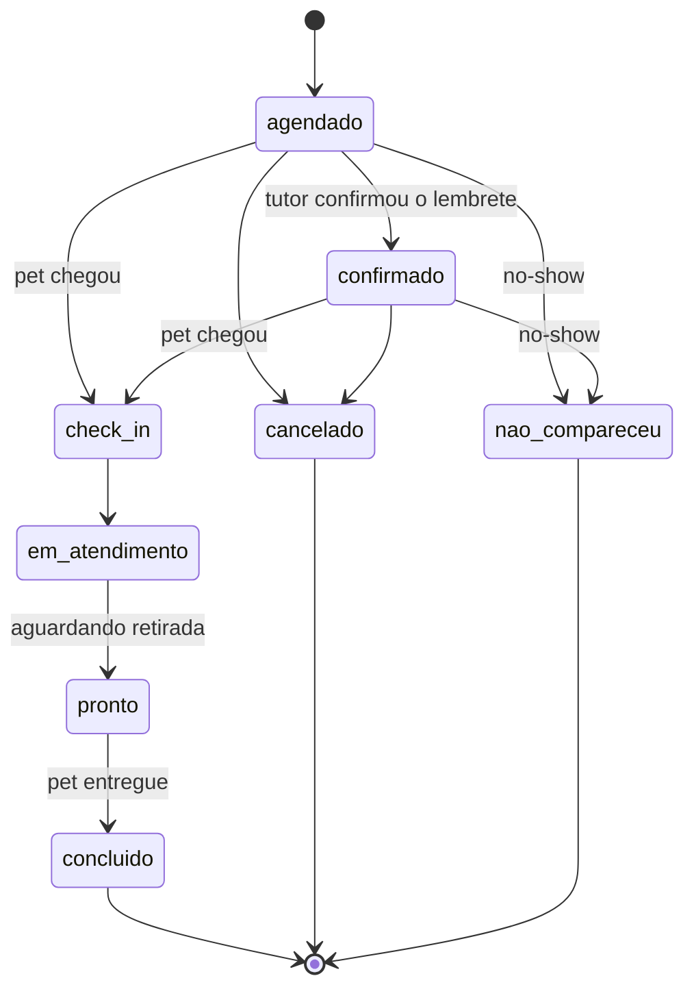
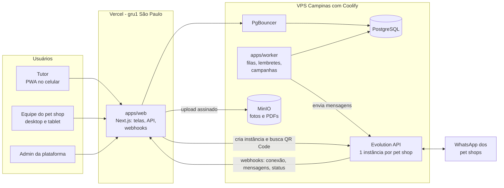
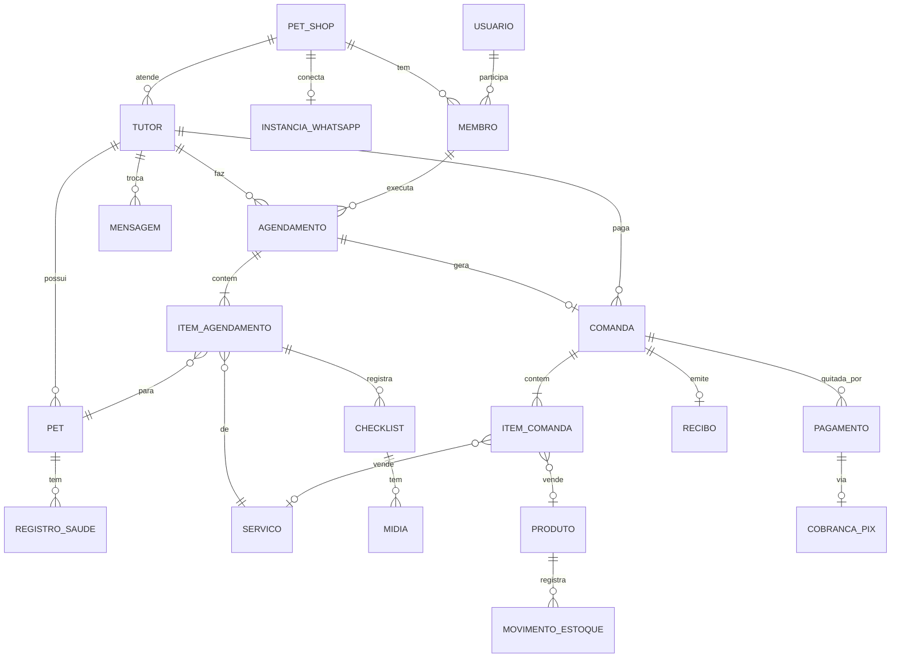

# PRD: Plataforma de Gestão para Pet Shops

> **Status:** rascunho v0.2, em discussão
> **Data:** 16/10/2026
> **Nome do produto:** a definir (provisório: "PetShop")
>
> Este documento é vivo. Itens marcados com 🔶 são **propostas que precisam de confirmação**. As perguntas em aberto estão na [seção 13](#13-perguntas-em-aberto).

## Decisões confirmadas

| Tema | Decisão |
|---|---|
| Modelo de negócio | **SaaS multi-tenant:** vários pet shops usam a mesma plataforma, cada um com seus dados isolados |
| Serviços | Cada pet shop cadastra os próprios serviços |
| Agenda | Agendamento com horário de início e fim; o fim vem da soma das durações dos serviços |
| PIX | **PIX estático** com a chave do próprio pet shop; sem intermediador de pagamento |
| Pagamento antecipado | Não obrigatório |
| WhatsApp | Evolution API; cada pet shop **conecta o próprio número lendo um QR Code** dentro do sistema |
| Infraestrutura | PostgreSQL e Evolution API na VPS (Campinas) com Coolify; aplicação web na Vercel |
| Sistema atual | Nenhum; não há dados para migrar |

---

## Sumário

1. [Visão geral](#1-visão-geral)
2. [Personas](#2-personas)
3. [Escopo funcional (módulos)](#3-escopo-funcional-módulos)
4. [Fluxos principais](#4-fluxos-principais)
5. [Regras de negócio](#5-regras-de-negócio)
6. [Requisitos não funcionais](#6-requisitos-não-funcionais)
7. [Arquitetura técnica](#7-arquitetura-técnica)
8. [Modelo de dados inicial](#8-modelo-de-dados-inicial)
9. [Integrações](#9-integrações)
10. [Roadmap por fases](#10-roadmap-por-fases)
11. [Métricas de sucesso](#11-métricas-de-sucesso)
12. [Riscos e mitigação](#12-riscos-e-mitigação)
13. [Perguntas em aberto](#13-perguntas-em-aberto)
14. [Histórico de versões](#14-histórico-de-versões)

---

## 1. Visão geral

### 1.1 Problema

Pet shops de banho e tosa costumam operar com agenda no caderno ou no WhatsApp, cadastro em planilha e estoque controlado de memória. Isso gera:

- horários perdidos, encaixes desorganizados e faltas (no-show) sem consequência;
- clientes que deixam de voltar sem que ninguém perceba;
- falta ou sobra de produtos e perdas por vencimento;
- nenhum histórico do pet (o que foi feito, como ele chegou, alergias, comportamento);
- pouca informação para decidir preço, equipe e compras.

### 1.2 Proposta

Uma plataforma SaaS em que cada pet shop cria a sua conta e passa a operar de ponta a ponta:

- **O tutor** agenda pelo celular, paga por PIX e recebe confirmação, lembretes, aviso de "pet pronto" e recibo pelo WhatsApp do próprio pet shop.
- **A equipe** opera agenda, atendimento com checklist, vendas, caixa e estoque num só lugar.
- **O dono do pet shop** acompanha resultados em tempo real, e o sistema age sozinho para trazer o cliente de volta (lembretes de banho, pacotes, campanhas).
- **Nós (plataforma)** acompanhamos os pet shops assinantes, a saúde das conexões de WhatsApp e o uso do sistema.

O primeiro pet shop a usar o sistema (piloto) valida a operação antes de abrirmos para outros. 🔶

### 1.3 Objetivos

| # | Objetivo | Indicador principal |
|---|---|---|
| O1 | Aumentar a recorrência dos clientes do pet shop | Taxa de retorno em 30/60 dias; intervalo médio entre visitas por pet |
| O2 | Reduzir faltas e horários ociosos | % de no-show; taxa de ocupação da agenda |
| O3 | Receber sem atrito | % do faturamento via PIX; tempo entre atendimento e pagamento |
| O4 | Vender mais por cliente | Ticket médio; % de atendimentos com adicional ou produto |
| O5 | Ter controle operacional | Rupturas de estoque; divergência no inventário; tempo de check-in |
| O6 | Permitir que um pet shop novo comece sozinho | Tempo entre criar a conta e o primeiro atendimento registrado |

### 1.4 Fora de escopo (por enquanto)

- Módulos específicos de clínica veterinária (prontuário, receitas) e de hotel ou creche (estadias de vários dias). Os pet shops podem cadastrar esses serviços na agenda, mas sem funções próprias.
- E-commerce com entrega.
- Emissão de nota fiscal (NFS-e/NFC-e) no MVP. Entra na Fase 4.
- Confirmação automática de PIX. Com PIX estático, a confirmação é feita pela equipe (ver [3.8](#38-pagamentos-pix-estático)). Integração opcional com um intermediador fica para a Fase 4.
- App nativo nas lojas. O portal do tutor será um PWA (instalável pelo navegador).

---

## 2. Personas

| Persona | Quem é | O que precisa |
|---|---|---|
| **Administrador da plataforma** | Nós, donos do SaaS | Ver os pet shops cadastrados, status e uso; dar suporte; acompanhar as conexões de WhatsApp |
| **Dono / gestor do pet shop** | Assinante; decide preço, equipe e compras | Configurar o pet shop sozinho; visão do faturamento, da agenda e da recorrência; alertas; relatórios; controle de descontos e estornos |
| **Recepção / atendente** | Atende balcão, telefone e WhatsApp | Agendar rápido, fazer check-in, cobrar, conferir PIX, vender produtos, abrir e fechar o caixa |
| **Banhista / tosador** | Executa os serviços | Ver a fila do dia num tablet, saber as restrições de cada pet, preencher o checklist e tirar fotos com poucos toques |
| **Tutor (cliente do pet shop)** | Dono do pet | Agendar sem ligar, pagar por PIX, saber quando o pet está pronto, ver o histórico e os recibos |

---

## 3. Escopo funcional (módulos)

Legenda de fase: **[F0]** fundação da plataforma · **[F1]** MVP de operação · **[F2]** portal do tutor · **[F3]** recorrência e CRM · **[F4]** gestão avançada e comercialização. Ver [roadmap](#10-roadmap-por-fases).

### 3.1 Plataforma multi-tenant e onboarding

- **[F0]** **Cadastro do pet shop (self-service):** o dono cria a conta com nome, e-mail, senha e telefone, e o sistema cria o pet shop (tenant) com um endereço próprio (slug).
- **[F0]** **Assistente de configuração inicial**, em passos:
  1. dados do pet shop (nome, CNPJ ou CPF, endereço, logo, fuso horário);
  2. horário de funcionamento;
  3. chave PIX (tipo, chave, nome e cidade do recebedor);
  4. **conexão do WhatsApp por QR Code** (ver [3.13](#313-whatsapp-evolution-api));
  5. equipe (convites por e-mail ou WhatsApp);
  6. serviços, a partir de uma lista sugerida que o pet shop edita (banho, tosa higiênica, tosa máquina…).
- **[F0]** Um usuário pode pertencer a mais de um pet shop (ex.: dono com duas lojas) e alternar entre eles.
- **[F0]** **Painel da plataforma** (só para nós): lista de pet shops, status (teste, ativo, suspenso), status do WhatsApp de cada um, uso (agendamentos, mensagens) e acesso de suporte com registro em auditoria.
- **[F4]** Planos, limites e cobrança da mensalidade dos pet shops. 🔶 Ver [pergunta 4](#13-perguntas-em-aberto).
- **[F4]** Domínio próprio por pet shop (ex.: `agenda.petshopdojoao.com.br`).

### 3.2 Clientes (tutores)

- **[F1]** Cadastro: nome, **telefone WhatsApp (identificador principal)**, e-mail, CPF (opcional), endereço, como conheceu o pet shop, observações e tags.
- **[F1]** Consentimento de marketing (opt-in) com data e origem, como exige a LGPD.
- **[F1]** Busca rápida por nome, telefone ou nome do pet.
- **[F1]** Ficha do tutor: pets, agendamentos, compras, pagamentos, valores em aberto, recibos, mensagens trocadas.
- **[F3]** Indicadores na ficha: última visita, frequência média, total gasto, ticket médio, NPS.
- **[F3]** Importação via planilha (para pet shops que chegam vindos de outro sistema).

### 3.3 Pets

- **[F1]** Cadastro: nome, espécie, raça, porte, tipo de pelagem, sexo, data de nascimento, peso, castrado, cor, foto.
- **[F1]** Alertas para a equipe: temperamento (ex.: morde, ansioso), alergias, condições de saúde, restrições (ex.: "não usar secador", "só shampoo hipoalergênico"). Esses alertas aparecem com destaque na agenda e no checklist.
- **[F1]** Histórico do pet: serviços realizados, checklists, fotos de antes e depois, evolução do peso.
- **[F3]** Carteira de saúde: vacinas, vermífugo e antipulgas, com data da próxima dose (alimenta os lembretes).
- **[F3]** Frequência desejada de banho (ex.: a cada 7, 15 ou 30 dias).
- Um pet tem um tutor principal; tutores secundários (ex.: outro membro da família) ficam para depois.

### 3.4 Catálogo de serviços

- **[F1]** Cada pet shop cadastra os próprios serviços: nome, categoria, descrição, **duração**, **preço**, se é adicional (add-on) e se aparece no portal do tutor.
- **[F1]** 🔶 Variação opcional de preço e duração por porte (e, se o pet shop quiser, por pelagem). Ex.: banho P 40 min por R$ 50, banho G 90 min por R$ 90. Sem variação cadastrada, vale o padrão do serviço.
- **[F1]** Serviços adicionais que podem ser incluídos no agendamento ou durante o atendimento (desembolo, hidratação, corte de unhas…).
- **[F1]** Cada serviço pode ter um template de checklist (ver [3.6](#36-atendimento-e-checklist)).
- **[F1]** Profissionais habilitados por serviço (ex.: só a Ana faz tosa da raça).

### 3.5 Agenda

- **[F1]** Cada agendamento tem **horário de início e de fim**. O fim é calculado pela soma das durações dos serviços escolhidos e pode ser ajustado manualmente pela equipe.
- **[F1]** 🔶 Cada agendamento é atribuído a um profissional, e um profissional não pode ter dois agendamentos sobrepostos. Se o pet shop não quiser controlar por pessoa, pode cadastrar colunas genéricas (ex.: "Mesa 1", "Mesa 2").
- **[F1]** Visões por dia e por semana, com uma coluna por profissional.
- **[F1]** Jornada de trabalho por profissional, horário de funcionamento, feriados e bloqueios (folga, reunião).
- **[F1]** Cálculo de horários livres: jornada − bloqueios − agendamentos existentes, considerando a duração total dos serviços e um intervalo de limpeza configurável.
- **[F1]** Agendamento pelo balcão, com encaixe e arrastar-e-soltar para remarcar.
- **[F1]** Um agendamento pode ter **vários pets do mesmo tutor**, cada um com seus serviços.
- **[F1]** Status do agendamento (o pagamento tem status próprio, na comanda):



- **[F1]** Fila do dia para o tablet dos banhistas (o que chegou, o que está em atendimento, o que está pronto).
- **[F3]** Agendamento recorrente fixo (ex.: "toda sexta às 9h, a cada 15 dias").
- **[F4]** Taxi dog: janelas de busca e entrega e roteiro do motorista.

### 3.6 Atendimento e checklist

O checklist protege o pet shop (documenta como o pet chegou) e padroniza o serviço.

- **[F1] Entrada (check-in):** peso atual (atualiza a ficha), pele e pelagem, pulgas ou carrapatos, lesões ou feridas, nós, ouvidos, unhas, comportamento, pertences deixados (coleira, guia, roupa) e observações do tutor.
  - Se marcar lesão ou ferida, **foto obrigatória** e ciência do tutor (aceite no tablet; na F2, também pelo WhatsApp).
- **[F1] Execução:** etapas definidas pelo template do serviço (escovação, banho, secagem, unhas, ouvidos, perfume, laço ou bandana…), com registro de quem fez e quando.
- **[F1] Saída:** fotos de depois, observações e recomendações para o tutor (ex.: "pele ressecada, recomendamos hidratação") e sugestão de próximo agendamento.
- **[F1] Ocorrências:** registro obrigatório de incidentes (corte, reação alérgica, fuga) com notificação imediata ao gestor.
- **[F1]** Templates de checklist configuráveis por serviço, com um modelo padrão sugerido pela plataforma.
- **[F2]** Pedido de autorização ao tutor pelo WhatsApp para serviço adicional encontrado durante o atendimento (ex.: "Encontramos muitos nós. Autoriza o desembolo por R$ 30? Responda SIM"), lançado na comanda automaticamente se aprovado.
- Interface pensada para **tablet**, com botões grandes e câmera integrada.

### 3.7 Vendas (PDV e comanda)

- **[F1]** **Comanda** aberta automaticamente para cada agendamento, com os serviços; recebe adicionais e produtos durante o atendimento.
- **[F1]** **Venda avulsa** no balcão (só produtos), com leitor de código de barras.
- **[F1]** Descontos em valor ou percentual; acima de um limite, exige permissão de gerente.
- **[F1]** Formas de pagamento: PIX estático, dinheiro (com troco), cartão de débito ou crédito (registrado manualmente; a maquininha continua separada) e **pagamento dividido** entre formas.
- **[F1]** Comanda pode ser fechada **com pagamento pendente** (cliente paga depois). O valor fica "a receber" na ficha do tutor e no dashboard.
- **[F1]** **Caixa:** abertura com fundo de troco, sangria, suprimento e fechamento com conferência por forma de pagamento.
- **[F1]** Cancelamento ou estorno com permissão, motivo e devolução automática ao estoque.
- **[F3]** Pagamento com saldo de pacote, crédito do cliente ou cupom.

### 3.8 Pagamentos (PIX estático)

O pagamento vai **direto da conta do tutor para a conta do pet shop**. A plataforma não intermedia dinheiro, não cobra taxa por transação e não precisa de contrato com intermediador.

- **[F1]** O pet shop cadastra a chave PIX (CPF, CNPJ, e-mail, telefone ou aleatória), o nome e a cidade do recebedor.
- **[F1]** Para cada cobrança, o sistema gera localmente um **QR Code e um "PIX copia e cola"** no padrão do Banco Central (BR Code), já com o **valor** e uma **referência** da comanda.
- **[F1]** A cobrança pode ser mostrada na tela do balcão (tablet virado para o cliente) e/ou enviada no WhatsApp do tutor.
- **[F1]** **Confirmação manual:** como o PIX estático não avisa o sistema quando é pago, a equipe confere no app do banco e clica em "Confirmar recebimento". O sistema registra quem confirmou e quando.
- **[F1]** **Comprovante pelo WhatsApp:** se o tutor enviar o comprovante (imagem ou PDF) na conversa enquanto houver cobrança pendente para ele, o sistema anexa o arquivo à cobrança e avisa a recepção: "Comprovante recebido, conferir". A confirmação continua sendo feita por uma pessoa.
- **[F1]** Status da cobrança: `pendente` → `em_conferencia` (comprovante recebido) → `confirmada`, ou `cancelada`.
- **[F1]** Devoluções são feitas pelo pet shop no app do banco; o sistema só registra o estorno.
- **[F4]** 🔶 Integração opcional, por pet shop, com um intermediador (Asaas, Mercado Pago, Efí…) para PIX com confirmação automática e assinaturas com Pix Automático.
- **[F4]** Importação do extrato bancário (OFX) para conferência em lote.

### 3.9 Recibos

- **[F1]** Gerado automaticamente quando a comanda é quitada (todas as cobranças confirmadas).
- **[F1]** Numeração sequencial por pet shop, sem lacunas.
- **[F1]** Conteúdo: dados do pet shop, tutor, pet(s), itens, descontos, total, formas de pagamento, data e hora, número, e a frase "Este documento não possui valor fiscal".
- **[F1]** Entrega: PDF + link pelo WhatsApp, impressão A4 e em impressora térmica de 80 mm.
- **[F2]** Recibos disponíveis no portal do tutor.
- **[F4]** Nota fiscal (NFS-e para serviços, NFC-e para produtos) por meio de um provedor fiscal.

### 3.10 Estoque

- **[F1]** Produtos: SKU, código de barras (EAN), nome, categoria, marca, unidade, custo, preço de venda, margem, estoque mínimo, fornecedor, foto, ativo ou inativo.
- **[F1]** Tipo do produto: **revenda** (vai para o PDV) ou **insumo** (uso interno: shampoo, perfume, laço).
- **[F1]** O saldo é um **livro-razão de movimentações**: entrada por compra, saída por venda, consumo interno, ajuste, perda ou avaria, devolução. Cada movimentação registra usuário, motivo e referência. Nunca se edita o saldo diretamente.
- **[F1]** Custo médio ponderado.
- **[F1]** Alertas de estoque abaixo do mínimo.
- **[F4]** Controle de lote e validade (rações e medicamentos), com alerta de vencimento.
- **[F4]** Inventário (contagem) com ajuste automático das diferenças.
- **[F4]** Entrada por XML da NF-e do fornecedor; pedidos de compra.
- **[F4]** Baixa automática de insumos por serviço (ex.: banho porte G consome ~60 ml de shampoo).

### 3.11 Recorrência e CRM

É o módulo que diferencia o produto: o sistema trabalha para o cliente voltar.

- **[F1]** Na saída, a recepção recebe a sugestão "Agendar o próximo?", já com a data indicada pela frequência do pet.
- **[F3]** **"Hora do banho":** por pet, a data do próximo banho é calculada pela frequência configurada ou pela média do histórico. Alguns dias antes, o tutor recebe no WhatsApp um link de agendamento com pet e serviço já preenchidos. Se não agendar, há uma segunda tentativa; depois disso, o cliente entra na lista de reativação.
- **[F3]** **Pacotes pré-pagos:** ex.: 4 banhos por R$ X, com validade; o saldo é consumido automaticamente a cada atendimento.
- **[F3]** **Lembretes de saúde:** vacina, vermífugo e antipulgas próximos do vencimento.
- **[F3]** **Recompra de ração:** estimativa de quando o saco acaba (peso do saco ÷ consumo diário pelo peso do pet) e lembrete alguns dias antes.
- **[F3]** **Aniversário do pet**, com mensagem e cupom.
- **[F3]** **Reativação:** clientes sem visita há X dias recebem uma campanha.
- **[F3]** **NPS pós-atendimento:** nota de 0 a 10 pelo WhatsApp. Nota ≤ 6 gera alerta ao gestor; nota ≥ 9 recebe convite para avaliar no Google.
- **[F3]** **Fidelidade** 🔶 ([pergunta 10](#13-perguntas-em-aberto)): cartão digital (ex.: a cada 10 banhos, 1 grátis), cashback ou pontos. Cada pet shop escolhe e configura o seu.
- **[F3]** **Segmentação e campanhas:** filtros por espécie, porte, raça, última visita, ticket médio e serviço; envio com limite de velocidade, só para quem deu opt-in, com opt-out imediato.
- **[F4]** Programa de indicação.

### 3.12 Portal do tutor (PWA, mobile-first)

- **[F2]** Cada pet shop tem seu portal, com a marca dele, em um endereço próprio. 🔶 Proposta: `slug.dominio.com.br` (ver [7.4](#74-decisões-de-arquitetura)).
- **[F2]** Acesso por **telefone + código enviado no WhatsApp do pet shop**, sem senha.
- **[F2]** Primeiro acesso com cadastro rápido do tutor e do pet.
- **[F2]** Autoagendamento: pet → serviço(s) e adicionais → preço e duração → dia e horário livres → resumo → confirmação. **Sem pagamento obrigatório.**
- **[F2]** Opção "Quer adiantar o pagamento?" com o PIX do pet shop (o pet shop decide se mostra essa opção). A confirmação segue o fluxo manual de [3.8](#38-pagamentos-pix-estático).
- **[F2]** Meus agendamentos: reagendar ou cancelar dentro da política do pet shop.
- **[F2]** Histórico do pet com fotos de antes e depois, resumo do checklist e recibos.
- **[F2]** Atualizar dados, foto do pet e vacinas.
- **[F2]** **Links mágicos:** links enviados pelo WhatsApp já entram autenticados (token de curta duração e uso único).
- **[F3]** Saldo de pacotes, fidelidade e cupons.

### 3.13 WhatsApp (Evolution API)

#### Conexão do número do pet shop [F0]

Cada pet shop usa o **próprio número de WhatsApp**, conectado por ele mesmo dentro do sistema. Na plataforma, cada pet shop corresponde a uma instância na Evolution API.

- Tela **Configurações → WhatsApp**, também presente no assistente de configuração inicial.
- Ao clicar em "Conectar", o sistema cria a instância do pet shop na Evolution (se ainda não existir) e mostra o **QR Code** com as instruções: no celular, *WhatsApp → Aparelhos conectados → Conectar aparelho*.
- O QR Code se renova sozinho enquanto não for lido.
- **Alternativa ao QR Code:** código de pareamento por número. É necessário quando o dono está configurando pelo próprio celular e não tem como escanear a tela.
- A tela atualiza sozinha quando a conexão se completa e mostra o número conectado, o nome e a foto do perfil.
- Ações: **enviar mensagem de teste**, **desconectar** e **reconectar**.
- **Monitoramento:** se o número desconectar, o envio de mensagens daquele pet shop é pausado (as mensagens ficam na fila), aparece um aviso no topo do sistema e o dono é notificado por e-mail e pelo número da plataforma. Ao reconectar, a fila volta a andar.
- Antes de conectar, o pet shop aceita um termo de ciência sobre o uso de conexão não oficial e as boas práticas de envio (ver [riscos](#12-riscos-e-mitigação)). Recomendação: usar um número dedicado ao pet shop.
- **Número da plataforma:** a plataforma tem um número próprio para avisar os pet shops (ex.: "seu WhatsApp desconectou") e enviar o código de acesso do portal caso o número do pet shop esteja desconectado.

#### Mensagens transacionais

| Gatilho | Mensagem | Fase |
|---|---|---|
| Agendamento criado | Confirmação com data, hora, pet e serviços | F1 |
| Véspera (ex.: 18h do dia anterior) | Lembrete. Na F2, com "1 para confirmar, 2 para reagendar" | F1 |
| Check-in | "Recebemos o Thor 🐶" | F1 |
| Pronto | "O Thor está pronto para buscar!" + foto | F1 |
| Cobrança gerada | Valor + PIX copia e cola + QR Code | F1 |
| Comanda quitada | Recibo em PDF + link | F1 |
| Login no portal | Código de acesso | F2 |
| X horas após o atendimento | Pesquisa NPS | F3 |

#### Mensagens recebidas

- **[F1]** Comprovante de PIX (imagem ou PDF) de um tutor com cobrança pendente: anexado à cobrança, recepção avisada.
- **[F2]** Respostas aos lembretes (1 / 2), palavras-chave (ex.: AGENDAR → link) e SAIR ou PARAR (opt-out imediato).
- **[F1]** As demais mensagens continuam sendo respondidas pela equipe no próprio WhatsApp do pet shop (o celular segue funcionando normalmente). 🔶 Caixa de entrada dentro do sistema fica para depois.

#### Infraestrutura de envio

- **[F1]** Templates com variáveis (`{{tutor}}`, `{{pet}}`, `{{data}}`, `{{hora}}`…): a plataforma fornece o texto padrão e cada pet shop pode personalizar.
- **[F1]** Fila de envio por pet shop, com limite de velocidade e janela de horário (campanhas nunca entre 21h e 8h no fuso do pet shop).
- **[F1]** Registro de cada mensagem com status (enviada, entregue, lida, falhou).
- **[F4]** Atendente virtual com IA para responder dúvidas e agendar pelo próprio WhatsApp.

### 3.14 Relatórios e dashboard

- **[F1] Dashboard do dia:** faturamento de hoje e do mês (comparado ao mês anterior), agendamentos de hoje por status, ocupação da agenda, PIX aguardando conferência, valores a receber e alertas (estoque baixo, ocorrências, WhatsApp desconectado).
- **[F1]** Relatório de caixa e vendas por período e forma de pagamento.
- **[F3] Recorrência:** clientes ativos e inativos, taxa de retorno, intervalo médio entre visitas, coortes, resultado de campanhas e lembretes (mensagens → agendamentos → receita), NPS.
- **[F4] Completos:**
  - Vendas: faturamento por categoria, produto e serviço; ticket médio; descontos.
  - Agenda: ocupação por profissional e dia da semana; no-show e cancelamentos.
  - Equipe: atendimentos e **comissões** por profissional.
  - Estoque: valor em estoque, giro, curva ABC, itens parados, próximos ao vencimento.
  - Financeiro: fluxo de caixa, contas a pagar e receber, DRE simples.
- Exportação em CSV ou XLSX em todos os relatórios.
- **[F0/F4] Plataforma:** pet shops ativos, em teste e suspensos; uso por pet shop; conexões de WhatsApp; (F4) receita recorrente das assinaturas.

### 3.15 Equipe, permissões e configurações

- **[F0]** Usuários e papéis dentro de cada pet shop:

| Papel | Acesso |
|---|---|
| Dono / admin | Tudo no pet shop, inclusive configurações, WhatsApp, chave PIX e relatórios financeiros |
| Gerente | Operação completa, descontos acima do limite, estornos, ajustes de estoque, relatórios |
| Recepção | Clientes, pets, agenda, check-in, comanda, PDV, caixa, conferência de PIX |
| Banhista / tosador | Fila do dia, checklist, fotos, histórico do pet (sem valores financeiros) |
| Tutor | Somente o portal, com os próprios dados |

- Fora dos pet shops existe o papel **administrador da plataforma**, com acesso ao painel da plataforma.
- **[F0]** Configurações do pet shop: dados (logo, CNPJ, endereço, fuso horário), horário de funcionamento, feriados, chave PIX, WhatsApp, políticas (cancelamento, no-show, limite de desconto), templates de mensagens.
- **[F1]** **Log de auditoria** para ações sensíveis: descontos, confirmação de PIX, estornos, ajustes de estoque, exclusões, alterações de preço, acessos de suporte da plataforma.
- **[F4]** Comissão por profissional e por serviço.

---

## 4. Fluxos principais

### 4.1 Cadastro de um novo pet shop [F0]

1. O dono acessa o site, cria a conta e informa o nome do pet shop.
2. O assistente pede, em passos: dados do pet shop, horário de funcionamento, chave PIX, conexão do WhatsApp, equipe e serviços (partindo de uma lista sugerida).
3. Ao final, o sistema mostra o endereço do portal do pet shop e um checklist do que falta configurar.

**Critérios de aceite:**
- Um pet shop consegue sair do zero até o primeiro agendamento sem ajuda da plataforma.
- Os passos podem ser pulados e retomados depois.
- Nenhum dado de um pet shop aparece para outro, em nenhuma tela, busca, relatório ou exportação.

### 4.2 Conexão do WhatsApp por QR Code [F0]

1. Em *Configurações → WhatsApp*, o dono clica em "Conectar".
2. O sistema cria a instância do pet shop na Evolution API e mostra o QR Code (ou, se preferir, um código de pareamento para digitar no celular).
3. O dono abre o WhatsApp no celular do pet shop, vai em *Aparelhos conectados → Conectar aparelho* e lê o QR Code.
4. A Evolution avisa o sistema que a conexão abriu; a tela muda para "Conectado" com o número e o perfil.
5. O dono envia uma mensagem de teste para o próprio celular.

**Critérios de aceite:**
- O QR Code exibido está sempre válido (renova sozinho até ser lido ou até o dono fechar a tela).
- O status na tela muda em poucos segundos após a leitura, sem recarregar a página.
- Se o número desconectar, o dono é avisado e nenhuma mensagem é perdida (fica na fila até reconectar).
- O token da instância nunca chega ao navegador.

### 4.3 Atendimento no balcão [F1]

1. **Check-in:** a recepção localiza o agendamento (ou cria um encaixe), pesa o pet e preenche o checklist de entrada com fotos; o tutor dá ciência. O tutor recebe "Recebemos o Thor".
2. **Fila:** o banhista vê o pet no tablet com os alertas (temperamento, alergias, restrições) e inicia o atendimento.
3. **Execução:** marca as etapas do checklist. Se encontrar algo, lança um adicional na comanda.
4. **Pronto:** registra fotos de depois e recomendações. O status muda para `pronto` e o tutor recebe a foto e o aviso.
5. **Retirada:** a recepção fecha a comanda (serviços + adicionais + produtos) e recebe o pagamento (fluxo 4.4, dinheiro ou cartão), ou deixa como "a receber". Quando quitada, o recibo vai pelo WhatsApp e o sistema sugere o próximo agendamento.

**Critérios de aceite:**
- Do check-in ao recibo, sem papel e sem digitar os mesmos dados duas vezes.
- O banhista não vê valores financeiros.
- Pet com alerta de temperamento ou alergia mostra o aviso na fila e no checklist.

### 4.4 Pagamento com PIX estático [F1]

1. Na comanda, a recepção clica em "Cobrar com PIX". O sistema gera o QR Code e o copia e cola com a chave do pet shop, o valor e a referência da comanda.
2. O QR aparece na tela do balcão e/ou é enviado no WhatsApp do tutor.
3. O tutor paga pelo app do banco; o dinheiro cai direto na conta do pet shop.
4. A recepção confere no app do banco e clica em "Confirmar recebimento". Se o tutor mandar o comprovante pelo WhatsApp, ele aparece anexado à cobrança, que passa a `em_conferencia`.
5. Confirmado: a comanda é quitada e o recibo vai para o tutor.

**Critérios de aceite:**
- O QR Code é lido pelos principais apps de banco com valor e recebedor corretos (testar com pelo menos 5 bancos).
- A confirmação sempre registra quem confirmou e quando.
- Um comprovante recebido nunca confirma o pagamento sozinho.

### 4.5 Venda no balcão [F1]

1. A recepção abre uma venda, lê os códigos de barras (ou busca o produto) e associa o tutor (opcional).
2. Aplica desconto (dentro do limite do papel) e recebe o pagamento.
3. O estoque baixa no momento da finalização. O recibo é impresso e/ou enviado no WhatsApp.

### 4.6 Autoagendamento pelo tutor [F2]

1. O tutor abre o link do pet shop (bio do Instagram, WhatsApp, Google), informa o telefone e entra com o código recebido no WhatsApp.
2. Escolhe o pet (ou cadastra um), os serviços e adicionais, e vê o preço e a duração.
3. Escolhe dia e horário entre os disponíveis.
4. Confirma. O agendamento é criado como `agendado` e o tutor recebe a confirmação no WhatsApp. Se o pet shop permitir, pode adiantar o pagamento por PIX.
5. Na véspera, chega o lembrete. O tutor responde 1 (confirma) ou 2 (recebe o link para reagendar).

**Critérios de aceite:**
- Dois tutores nunca conseguem reservar o mesmo horário do mesmo profissional, mesmo clicando ao mesmo tempo (garantido no banco de dados, não só na tela).
- Só aparecem horários em que cabe a duração total dos serviços escolhidos.
- O fluxo inteiro funciona em um celular comum, em menos de 2 minutos, para quem já tem cadastro.

### 4.7 Ciclo de recorrência [F3]

1. Todo dia, o worker calcula para cada pet a data prevista do próximo banho.
2. X dias antes, envia "Faz 14 dias do último banho do Thor. Quer agendar?" com o link pronto.
3. Agendou: ótimo, o ciclo reinicia. Não agendou em Y dias: segunda tentativa. Depois, entra na lista de reativação.
4. O relatório mostra quantas mensagens viraram agendamentos e quanta receita geraram.

---

## 5. Regras de negócio

| ID | Regra |
|---|---|
| RN-01 | Todo dado de negócio pertence a um pet shop (tenant). Nenhuma consulta, busca, relatório, exportação ou arquivo pode cruzar pet shops. |
| RN-02 | O telefone WhatsApp é o identificador do tutor, único dentro de cada pet shop, armazenado no formato E.164 (`+55DDXXXXXXXXX`). O mesmo telefone pode ser cliente de pet shops diferentes, com cadastros independentes. |
| RN-03 | O porte é sugerido pelo peso, com faixas configuráveis por pet shop 🔶 (padrão: P até 10 kg, M de 10 a 25 kg, G de 25 a 45 kg, GG acima de 45 kg), e pode ser ajustado manualmente. |
| RN-04 | Fim do agendamento = início + soma das durações dos serviços (considerando a variação por porte, se houver) + intervalo de limpeza. A equipe pode ajustar o fim manualmente. |
| RN-05 | Um profissional não pode ter agendamentos sobrepostos (exceto cancelados e no-show). 🔶 |
| RN-06 | 🔶 O tutor pode cancelar ou reagendar pelo portal até X horas antes (configurável). Depois disso, só falando com o pet shop. |
| RN-07 | 🔶 No-show é marcado manualmente ou automaticamente após X minutos de tolerância. Após N no-shows, o tutor perde o autoagendamento e só agenda pelo balcão (configurável). |
| RN-08 | Valores monetários são guardados em centavos (inteiro). Datas e horas são guardadas em UTC e exibidas no fuso horário do pet shop (padrão `America/Sao_Paulo`). |
| RN-09 | PIX estático só é marcado como pago por uma pessoa da equipe, nunca automaticamente. O comprovante enviado pelo tutor é só um anexo para conferência. |
| RN-10 | O saldo de estoque só muda por movimentação. A venda baixa o estoque ao ser finalizada; o cancelamento devolve. |
| RN-11 | Recibo só é emitido para comanda quitada. A numeração é sequencial e sem lacunas por pet shop. |
| RN-12 | Mensagens de marketing só vão para quem deu opt-in, e o opt-out vale imediatamente. Mensagens transacionais (confirmação, lembrete, recibo) são sempre enviadas. |
| RN-13 | Desconto acima do limite do papel exige aprovação de gerente, registrada na auditoria. |
| RN-14 | Lesão ou ferida identificada no check-in exige foto e ciência do tutor antes de iniciar o serviço. |
| RN-15 | Webhooks (Evolution API) são idempotentes: o mesmo evento nunca é processado duas vezes. |

---

## 6. Requisitos não funcionais

| Tema | Requisito |
|---|---|
| Isolamento entre pet shops | Garantido em duas camadas (aplicação e banco; ver [7.4](#74-decisões-de-arquitetura)) e coberto por testes automatizados que tentam acessar dados de outro pet shop. |
| Plataformas | Web responsiva. Portal do tutor mobile-first e instalável (PWA). Checklist e fila otimizados para tablet. Gestão otimizada para desktop. |
| Desempenho | p95 abaixo de 500 ms nas telas principais. Functions da Vercel em São Paulo (`gru1`), perto da VPS em Campinas. |
| Segurança | HTTPS em tudo. Controle de acesso por papel no servidor (não só na tela). Limite de tentativas em login e envio de código. Validação do token dos webhooks. Segredos só em variáveis de ambiente; tokens das instâncias de WhatsApp criptografados no banco. Postgres com SSL obrigatório e usuário da aplicação com privilégios mínimos. |
| LGPD | Cada pet shop é o controlador dos dados dos seus clientes; a plataforma é a operadora. Termos de uso e contrato de tratamento de dados com os pet shops. Política de privacidade. Consentimento de marketing registrado. CPF opcional. Exportação e exclusão dos dados do titular a pedido. Log de acesso, inclusive acessos de suporte. |
| Backup | Dump automático diário do Postgres (Coolify) enviado para armazenamento externo à VPS, retenção de 30 dias, teste de restauração mensal documentado. |
| Observabilidade | Rastreamento de erros (Sentry), logs estruturados com o pet shop identificado, painel das filas, monitor de disponibilidade (Uptime Kuma no Coolify) para Postgres, Evolution API e worker. |
| Localização | Português do Brasil, BRL, datas no formato dd/mm/aaaa, fuso por pet shop. |
| Acessibilidade | Contraste e tamanhos de toque adequados (WCAG AA básico), especialmente no tablet e no portal. |
| Auditoria | Ações sensíveis registradas com usuário, data e valores antes e depois. |
| Ambientes | Produção e homologação separadas, cada uma com seu banco e sua Evolution. Deploys de preview da Vercel nunca apontam para o banco de produção. |

---

## 7. Arquitetura técnica

### 7.1 Visão geral



O PIX estático não aparece no diagrama porque não tem integração: o QR Code é gerado pelo próprio sistema e o dinheiro vai direto do banco do tutor para o banco do pet shop.

### 7.2 Stack

| Camada | Escolha | Status | Motivo |
|---|---|---|---|
| Banco de dados | PostgreSQL na VPS (Coolify) | ✅ definido | |
| WhatsApp | Evolution API na VPS (Coolify), uma instância por pet shop | ✅ definido | |
| Hospedagem web | Vercel, região `gru1` (São Paulo) | ✅ definido | VPS em Campinas, a ~100 km |
| PIX | BR Code estático gerado pelo próprio sistema | ✅ definido | Sem intermediador e sem taxa |
| Framework | Next.js (App Router) + TypeScript | 🔶 proposta | Padrão da Vercel; telas, API e webhooks no mesmo projeto |
| UI | Tailwind CSS + shadcn/ui | 🔶 proposta | Componentes prontos e acessíveis, fácil de aplicar a marca de cada pet shop |
| Formulários e validação | React Hook Form + Zod | 🔶 proposta | Mesma validação no cliente e no servidor |
| ORM e migrações | Drizzle ORM + drizzle-kit | 🔶 proposta | Leve em ambiente serverless, SQL explícito e tipado, suporte a RLS |
| Pool de conexões | PgBouncer (modo transaction) no Coolify | 🔶 proposta | Necessário com serverless (ver 7.3) |
| Autenticação | Better Auth | 🔶 proposta | E-mail e senha para a equipe, código por telefone para o tutor (enviado pela Evolution), organizações (= pet shops), convites e papéis |
| Filas e agendamentos | pg-boss + worker Node no Coolify | 🔶 proposta | A fila mora no próprio Postgres (sem Redis extra); suporta cron; tarefas longas fora da Vercel |
| Arquivos (fotos, PDFs) | Armazenamento compatível com S3: MinIO no Coolify ou Cloudflare R2 | 🔶 proposta | Upload direto do navegador com URL assinada; pasta por pet shop |
| QR Code e PDF | `qrcode` + @react-pdf/renderer | 🔶 proposta | Geração local do QR do PIX e dos recibos |
| Monorepo | pnpm + Turborepo | 🔶 proposta | Web e worker compartilham schema e regras |
| Qualidade | ESLint, Prettier, Vitest, Playwright, GitHub Actions | 🔶 proposta | |
| Observabilidade | Sentry + Uptime Kuma | 🔶 proposta | |

### 7.3 Pontos de atenção: Vercel ↔ VPS

1. **Conexões:** funções serverless abrem muitas conexões ao banco. Por isso, PgBouncer em modo transaction na frente do Postgres, com o driver configurado sem prepared statements. As migrações usam a conexão direta.
2. **Latência:** com as Functions em `gru1` e a VPS em Campinas, cada consulta leva poucos milissegundos de rede. Mesmo assim, evitar consultas em cascata (N+1).
3. **Exposição do Postgres:** a Vercel não tem IP de saída fixo nos planos comuns, então não dá para liberar só o IP dela no firewall. O PgBouncer fica exposto com SSL obrigatório, senha forte, porta não padrão e usuário com privilégios mínimos; o Postgres em si não fica exposto.
4. **Exposição da Evolution API:** acessível por HTTPS em um subdomínio (Traefik do Coolify), chamada só pelo servidor (Vercel e worker) com a chave global, que nunca vai para o navegador.
5. **Tarefas agendadas:** lembretes, campanhas e envio de mensagens rodam no **worker no Coolify**, não no Cron da Vercel (que tem limites de frequência por plano).
6. **Webhooks** da Evolution chegam na Vercel: validam o token, identificam o pet shop pela instância, gravam o evento bruto e o processam de forma idempotente.
7. **Plano da Vercel:** o plano Hobby é só para uso pessoal e não comercial. Um SaaS precisa do plano **Pro**.

### 7.4 Decisões de arquitetura

- **Multi-tenant com banco compartilhado:** um único banco, e toda tabela de negócio tem `organization_id`. É o modelo mais simples de operar e de evoluir com muitos pet shops pequenos.
- **Isolamento em duas camadas** 🔶:
  1. na aplicação, todo acesso a dados passa por uma camada que exige o pet shop atual e o aplica em toda consulta;
  2. no banco, **Row-Level Security (RLS)** do Postgres como rede de segurança: cada transação informa o pet shop atual e o próprio banco recusa linhas de outro pet shop.
- **Identificação do pet shop:** na gestão, vem da sessão do usuário (pet shop ativo); no portal do tutor, vem do endereço acessado.
- **Endereços** 🔶: gestão em `app.dominio.com.br`; portal de cada pet shop em `slug.dominio.com.br` (subdomínio coringa na Vercel). Domínio próprio por pet shop fica para a Fase 4.
- **Regras de negócio em `packages/core`**, sem depender de framework: cálculo de preço e duração, horários livres, BR Code do PIX, estoque e recorrência são testados de forma isolada e usados tanto pela web quanto pelo worker.
- **Conflito de agenda garantido pelo banco:** restrição de exclusão no Postgres (`EXCLUDE USING gist` sobre profissional + intervalo de tempo, ignorando cancelados), para que dois agendamentos do mesmo profissional nunca se sobreponham.
- **Integrações atrás de interfaces** (`MessagingProvider` para WhatsApp, `PaymentProvider` para PIX): permite adicionar um intermediador de PIX ou a API oficial do WhatsApp no futuro sem afetar o resto do sistema.
- **Envio de WhatsApp sempre pela fila**, separada por pet shop: a tela nunca espera a Evolution responder, e um pet shop desconectado não trava os outros.
- **Nomes no código e no banco em inglês, interface em português.** 🔶

### 7.5 Estrutura do repositório

```
petshop/
├── apps/
│   ├── web/            # Next.js → Vercel (gestão, portal do tutor, painel da plataforma, API, webhooks)
│   └── worker/         # Node → Docker no Coolify (filas, agendador, envios)
├── packages/
│   ├── db/             # schema Drizzle, migrações, políticas RLS, seeds
│   ├── core/           # regras de negócio (preço, horários, PIX BR Code, estoque, recorrência)
│   ├── integrations/   # cliente da Evolution API (e futuros intermediadores de PIX)
│   └── config/         # configurações compartilhadas (tsconfig, eslint)
└── docs/               # PRD, decisões de arquitetura, guias de deploy
```

---

## 8. Modelo de dados inicial

### 8.1 Relacionamentos principais



### 8.2 Entidades

Todas as tabelas de negócio têm `id` (UUID), `organization_id`, `created_at` e `updated_at`, e são protegidas por RLS; cadastros usam exclusão lógica (`deleted_at`).

| Domínio | Entidade → tabela | Campos principais |
|---|---|---|
| Plataforma | Pet shop → `organizations` | nome, slug, CNPJ ou CPF, endereço, logo, fuso horário, horário de funcionamento, status (teste, ativo, suspenso), configurações |
| | Usuário → `users` | nome, e-mail, telefone, administrador da plataforma? |
| | Membro → `members` | usuário, pet shop, papel, ativo |
| | Convite → `invitations` | pet shop, e-mail ou telefone, papel, expira em |
| | Configuração PIX → `pix_settings` | pet shop, tipo de chave, chave, nome do recebedor, cidade |
| | Instância WhatsApp → `whatsapp_instances` | pet shop, nome da instância, token (criptografado), servidor Evolution, status (desconectado, aguardando leitura, conectado), número, nome do perfil, conectado em, último evento |
| Clientes | Tutor → `customers` | nome, telefone (E.164, único por pet shop), e-mail, CPF, endereço, origem, opt-in de marketing, tags, observações |
| | Pet → `pets` | tutor, nome, espécie, raça, porte, pelagem, sexo, nascimento, peso, castrado, temperamento, alergias, restrições, foto, frequência de banho |
| | Registro de saúde → `pet_health_records` | pet, tipo (vacina, vermífugo, antipulgas), produto, data, próxima dose |
| Catálogo | Serviço → `services` | nome, categoria, descrição, preço, duração, adicional?, disponível no portal?, template de checklist |
| | Variação do serviço → `service_variants` | serviço, porte, pelagem, preço, duração |
| | Profissional × serviço → `member_services` | membro, serviço |
| | Produto → `products` | SKU, EAN, nome, categoria, marca, tipo (revenda ou insumo), custo médio, preço, estoque mínimo |
| | Fornecedor → `suppliers` | nome, CNPJ, contato |
| Agenda | Jornada → `work_schedules` | membro, dia da semana, início, fim |
| | Bloqueio → `schedule_blocks` | membro (ou geral), período, motivo |
| | Agendamento → `appointments` | tutor, profissional, início, fim, status, origem (balcão, portal, WhatsApp), recorrência |
| | Item do agendamento → `appointment_items` | agendamento, pet, serviço, preço, duração |
| | Histórico de status → `appointment_events` | agendamento, de, para, usuário, data |
| Atendimento | Template de checklist → `checklist_templates`, `checklist_template_items` | etapa (entrada, execução, saída), pergunta, tipo de resposta, obrigatório? |
| | Checklist → `checklists`, `checklist_answers` | item do agendamento, etapa, respostas, quem preencheu, quando |
| | Mídia → `media` | arquivo, tipo, vínculo (pet, checklist, ocorrência, comprovante), antes ou depois |
| | Ocorrência → `incidents` | item do agendamento, descrição, gravidade, fotos |
| Vendas | Comanda → `orders` | tutor, agendamento, status (aberta, a receber, paga, cancelada), subtotal, desconto, total |
| | Item da comanda → `order_items` | produto ou serviço, pet, quantidade, preço unitário, desconto |
| | Pagamento → `payments` | comanda, forma, valor, status, confirmado por, confirmado em |
| | Cobrança PIX → `pix_charges` | pagamento, valor, referência (txid), copia e cola, status (pendente, em conferência, confirmada, cancelada), comprovante |
| | Recibo → `receipts` | número, comanda, URL do PDF, enviado em |
| | Caixa → `cash_sessions`, `cash_movements` | abertura, fechamento, sangria, suprimento, conferência |
| Estoque | Movimento → `stock_movements` | produto, tipo, quantidade (±), custo unitário, referência, usuário, motivo |
| CRM | Pacote → `packages`, `customer_packages`, `package_usages` | serviços incluídos, validade, saldo |
| | Lembrete → `reminders` | tipo, pet ou tutor, data prevista, status, mensagem enviada |
| | Campanha → `campaigns`, `campaign_recipients` | segmento, template, agendada para, resultados |
| | Avaliação → `reviews` | comanda, nota, comentário |
| | Fidelidade → `loyalty_ledger` | tutor, movimento, saldo |
| WhatsApp | Template → `message_templates` | pet shop (vazio = padrão da plataforma), chave, texto, variáveis |
| | Mensagem → `messages` | direção, telefone, template, conteúdo, status, id na Evolution |
| Sistema | Auditoria → `audit_logs` | usuário, ação, entidade, antes, depois |
| | Evento de webhook → `webhook_events` | origem, id externo (único), payload, processado em |

---

## 9. Integrações

### 9.1 Evolution API (WhatsApp)

- **Uma instância por pet shop**, criada pelo sistema quando o pet shop clica em "Conectar". O nome da instância é derivado do id do pet shop.
- **Conexão:** o sistema pede à Evolution o QR Code (ou o código de pareamento) e o mostra na tela. A Evolution avisa por webhook quando o QR Code muda e quando a conexão abre ou fecha.
- **Saída:** o worker consome a fila de mensagens de cada pet shop e chama a Evolution (texto, imagem, documento PDF).
- **Entrada:** a Evolution envia webhooks (mensagem recebida, status de entrega, conexão, QR Code) para `apps/web`, que valida o token, identifica o pet shop pela instância, grava o evento e decide o que fazer (anexar comprovante, resposta automática, opt-out ou nada).
- **Capacidade:** cada instância consome memória na VPS. Monitorar o consumo e, quando necessário, adicionar um segundo servidor Evolution; cada instância guarda em qual servidor está.
- 🔶 A Evolution funciona tanto pela conexão não oficial (Baileys, via QR Code) quanto pela API oficial (WhatsApp Cloud API). Começamos pela não oficial, que é a que permite o QR Code. A oficial pode virar opção para pet shops que queiram fazer campanhas em volume.

### 9.2 PIX estático (BR Code)

- Geração local do payload no padrão EMV do Banco Central: chave PIX, nome do recebedor (até 25 caracteres), cidade (até 15 caracteres), valor, referência (txid, até 25 caracteres alfanuméricos) e CRC16.
- A partir do payload, o sistema gera o QR Code (imagem) e o texto copia e cola.
- Sem chamadas externas: funciona mesmo se algum serviço de terceiros estiver fora.
- Testes automatizados comparando com payloads de referência e testes manuais de leitura em vários bancos.
- **Futuro (F4):** `PaymentProvider` com intermediadores (Asaas, Mercado Pago, Efí…) para quem quiser confirmação automática ou assinaturas com Pix Automático.

### 9.3 Futuras

- Provedor fiscal para NFS-e e NFC-e (Fase 4).
- Caixa de entrada de atendimento humano (ex.: Chatwoot, que tem integração nativa com a Evolution).
- Google Business Profile (link de avaliação).

---

## 10. Roadmap por fases

Cada fase termina com o sistema em produção e em uso. A Fase 1 roda primeiro no pet shop piloto 🔶; a abertura para outros pet shops acontece quando o piloto estiver estável.

### Fase 0: Fundação da plataforma

- Monorepo, padrões de código, CI (lint, tipos, testes).
- Coolify: Postgres + PgBouncer + backups automáticos, Evolution API com HTTPS, MinIO, ambiente de homologação.
- Vercel (plano Pro, região `gru1`), domínio, previews.
- Base multi-tenant: cadastro do pet shop, login da equipe, convites, papéis, isolamento com RLS e testes de isolamento.
- Assistente de configuração inicial: dados, horário, chave PIX, **conexão do WhatsApp por QR Code** com mensagem de teste.
- Painel mínimo da plataforma: lista de pet shops e status do WhatsApp de cada um.
- **Pronto quando:** um pet shop cria a conta sozinho, convida a equipe, conecta o WhatsApp lendo o QR Code e recebe uma mensagem de teste.

### Fase 1: MVP de operação ("o pet shop roda no sistema")

- Tutores e pets.
- Serviços com duração e preço (com variação opcional por porte).
- Profissionais, jornadas e agenda com início e fim, fila do dia e status.
- Checklist de entrada, execução e saída com fotos; ocorrências.
- Produtos e estoque básico.
- Comanda, PDV, caixa e valores a receber.
- PIX estático com conferência manual e recebimento de comprovante pelo WhatsApp; registro de dinheiro e cartão.
- Recibo em PDF no WhatsApp.
- WhatsApp transacional: confirmação, lembrete na véspera, check-in, pet pronto, cobrança, recibo.
- Dashboard do dia; relatório de caixa e vendas.
- **Pronto quando:** um dia inteiro de operação real do piloto roda no sistema, do agendamento ao fechamento do caixa, sem caderno.

### Fase 2: Portal do tutor e autoagendamento

- Portal por pet shop, com a marca dele.
- Login por código no WhatsApp; links mágicos.
- Autoagendamento com horários livres conforme a duração dos serviços, sem pagamento obrigatório e com PIX opcional.
- Reagendar e cancelar com política.
- Histórico, fotos e recibos no portal.
- Confirmação do lembrete pela resposta no WhatsApp.
- Autorização de serviço adicional pelo WhatsApp.
- **Pronto quando:** um tutor novo agenda sozinho, sem falar com ninguém.

### Fase 3: Recorrência e CRM

- "Hora do banho" com link pronto; agendamento recorrente fixo.
- Pacotes pré-pagos.
- Lembretes de saúde, recompra de ração e aniversário.
- NPS e convite de avaliação no Google.
- Fidelidade.
- Segmentação, campanhas e reativação de inativos.
- Relatórios de recorrência e de resultado das campanhas.
- Importação de planilha para pet shops que vêm de outro sistema.

### Fase 4: Gestão avançada e comercialização

- Planos, limites e cobrança da mensalidade dos pet shops; período de teste; página de vendas. 🔶 Pode ser antecipado, conforme a [pergunta 4](#13-perguntas-em-aberto).
- Domínio próprio por pet shop.
- Relatórios completos com exportação; comissões.
- Compras, fornecedores, entrada por XML, lote e validade, inventário, curva ABC.
- Financeiro: contas a pagar e receber, fluxo de caixa, DRE simples.
- Nota fiscal (NFS-e e NFC-e).
- PIX com confirmação automática via intermediador (opcional por pet shop) e assinaturas com Pix Automático.
- Taxi dog com roteiro.
- Atendente virtual com IA no WhatsApp.

---

## 11. Métricas de sucesso

As metas numéricas serão definidas depois de 30 dias de uso do piloto, com a linha de base medida pelo próprio sistema.

**Por pet shop:**

| Métrica | Definição |
|---|---|
| Taxa de retorno 60 dias | % de tutores atendidos que voltaram em até 60 dias |
| Intervalo médio entre banhos | Média de dias entre atendimentos do mesmo pet |
| Clientes ativos | Tutores com pelo menos 1 atendimento nos últimos 90 dias |
| No-show | Faltas ÷ agendamentos |
| Ocupação da agenda | Minutos agendados ÷ minutos disponíveis |
| Agendamentos online | % dos agendamentos feitos pelo portal |
| Ticket médio | Faturamento ÷ número de comandas |
| Conversão de lembretes | Agendamentos gerados ÷ lembretes enviados |
| NPS | % promotores − % detratores |

**Da plataforma:**

| Métrica | Definição |
|---|---|
| Pet shops ativos | Pet shops com atendimentos registrados nos últimos 7 dias |
| Ativação | % de pet shops que registram o primeiro atendimento em até 7 dias após criar a conta |
| WhatsApp conectado | % de pet shops ativos com o WhatsApp conectado |
| Churn | % de pet shops que deixam de usar ou cancelam no mês |

---

## 12. Riscos e mitigação

| Risco | Impacto | Mitigação |
|---|---|---|
| Dados de um pet shop visíveis para outro | Crítico | Isolamento em duas camadas (aplicação + RLS); testes automatizados de isolamento em toda funcionalidade nova; revisão de código focada nisso |
| Bloqueio do número de WhatsApp de um pet shop (conexão não oficial) | Alto | Termo de ciência na conexão; recomendação de número dedicado; só mensagens esperadas pelo cliente; opt-in para marketing; limite de velocidade e janela de horário por pet shop; nada de disparo para lista fria; API oficial como opção futura |
| VPS como ponto único de falha (banco, WhatsApp e worker de todos os pet shops) | Alto | Backups fora da VPS com teste de restauração; monitoramento com alerta; procedimento de recuperação documentado; plano de crescimento (servidor separado para Evolution) |
| Capacidade da Evolution com muitas instâncias | Médio | Monitorar memória por instância; limite de instâncias por servidor; suporte a mais de um servidor Evolution desde o modelo de dados |
| PIX estático sem confirmação automática; comprovante falso | Médio | Confirmação só por pessoa após conferir no banco; registro de quem confirmou; intermediador opcional no futuro |
| Latência e excesso de conexões entre Vercel e VPS | Baixo | PgBouncer; `gru1` perto de Campinas; consultas enxutas |
| Escopo grande demais | Alto | Fases curtas com uso real no piloto; backlog priorizado a cada fase |
| Equipe do pet shop não adotar o sistema | Médio | Telas simples, tablet no salão, assistente de configuração, modelos prontos (serviços, checklist, mensagens) |
| Recibo não substitui nota fiscal | Médio | Deixar claro no recibo; fase fiscal planejada |
| LGPD (plataforma como operadora de dados de vários pet shops) | Médio | Termos de uso e contrato de tratamento de dados; consentimento; minimização; exclusão a pedido; log de acessos de suporte |

---

## 13. Perguntas em aberto

### Agenda e serviços

1. **Profissional por agendamento:** cada agendamento é de um profissional, e o mesmo profissional não pode ter dois horários sobrepostos? (É a proposta atual; pet shops que não controlam por pessoa usariam colunas como "Mesa 1".)
2. **Variação por porte:** o mesmo serviço pode ter preço e duração diferentes por porte (ex.: banho P 40 min, banho G 90 min)? A proposta é deixar isso opcional para cada pet shop.

### Plataforma (SaaS)

3. **O seu pet shop é o piloto** (primeiro a usar)?
4. **Como vão cobrar os pet shops?** Mensalidade fixa, planos por tamanho? A cobrança precisa estar no sistema desde o começo ou pode ser manual no início?
5. **Nome do produto e domínio.** O portal de cada pet shop em subdomínio (`petshopdojoao.dominio.com.br`) está bom?
6. **Número de WhatsApp da plataforma:** vamos ter um número próprio para avisar os pet shops e para enviar o código de acesso quando o número do pet shop estiver desconectado?

### Infraestrutura

7. A **Evolution API** já está instalada no Coolify? Qual versão? Qual o tamanho da VPS (CPU e RAM)?
8. Qual o **plano da Vercel** (Hobby ou Pro)?

### Operação (podem esperar)

9. Os banhistas e tosadores ganham **comissão**?
10. **Fidelidade:** cartão (ex.: 10º banho grátis), cashback ou pontos?
11. Querem **vender produtos online** (retirada ou entrega)?
12. Para o piloto: **impressora térmica**, **leitor de código de barras** e **tablet** para os banhistas?

### Respondidas

| Pergunta | Resposta (16/10/2026) |
|---|---|
| Só o seu pet shop ou SaaS? | SaaS multi-tenant |
| Quais serviços? | Cada pet shop cadastra os seus |
| Como funciona a agenda? | Início e fim; cada serviço tem sua duração |
| Pagamento antecipado? | Não obrigatório |
| Qual PSP para PIX? | Nenhum: PIX estático |
| Onde está a VPS? | Campinas |
| Evolution e número? | Cada pet shop conecta o próprio WhatsApp pelo QR Code no sistema |
| Usam algum sistema hoje? | Não |

---

## 14. Histórico de versões

| Versão | Data | Mudança |
|---|---|---|
| 0.1 | 16/10/2026 | Rascunho inicial a partir da conversa de kickoff |
| 0.2 | 16/10/2026 | SaaS multi-tenant (onboarding, painel da plataforma, isolamento com RLS); serviços cadastrados por pet shop; agenda com início e fim pela duração dos serviços; PIX estático com conferência manual e comprovante pelo WhatsApp; pagamento antecipado não obrigatório; conexão do WhatsApp por QR Code (uma instância da Evolution por pet shop); VPS em Campinas com Vercel em `gru1`; importação de dados movida para a Fase 3 |
