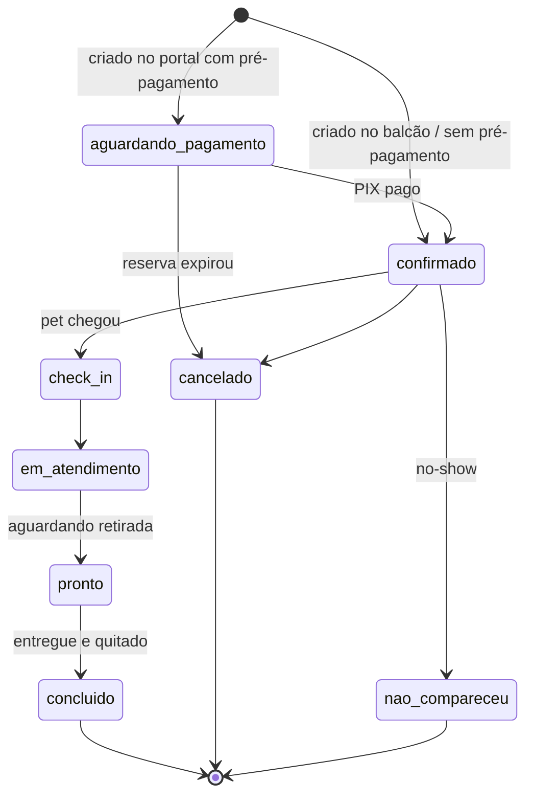
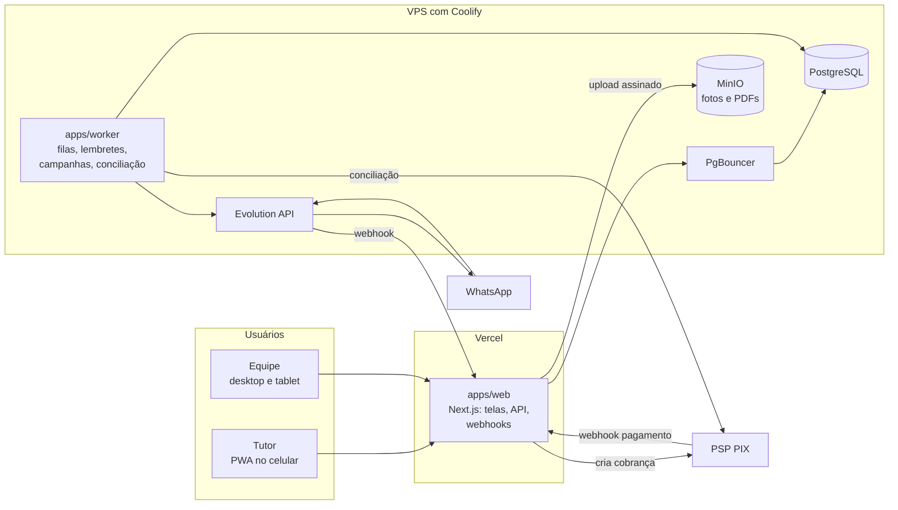
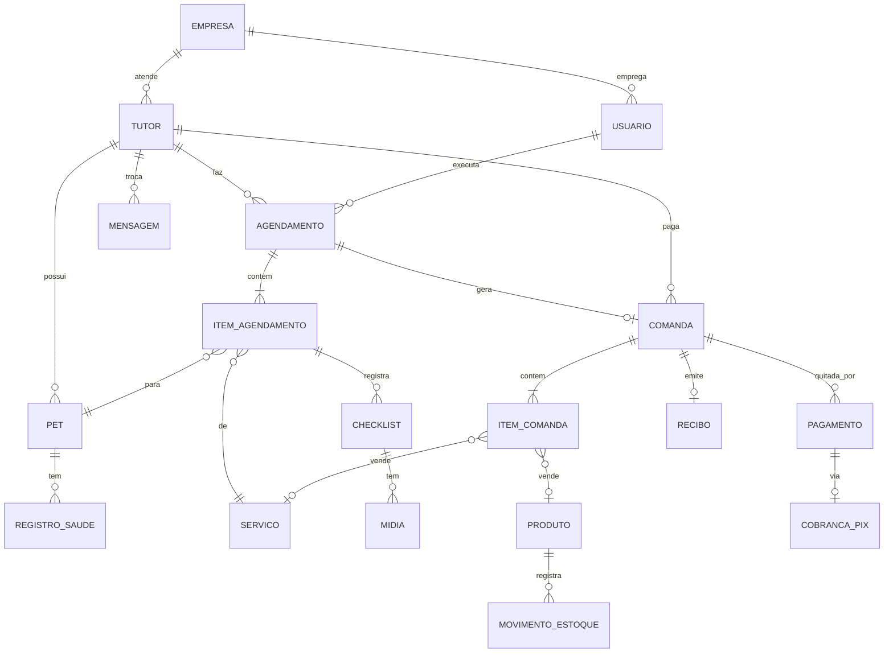

# PRD: Sistema de Gestão para Pet Shop

> **Status:** rascunho v0.1, em discussão
> **Data:** 16/10/2026
> **Nome do produto:** a definir (provisório: "PetShop")
>
> Este documento é vivo. Itens marcados com 🔶 são **propostas que precisam de confirmação**. As perguntas em aberto estão na [seção 13](#13-perguntas-em-aberto).

---

## Sumário

1. [Visão geral](#1-visão-geral)
2. [Personas](#2-personas)
3. [Escopo funcional (módulos)](#3-escopo-funcional-módulos)
4. [Fluxos principais](#4-fluxos-principais)
5. [Regras de negócio](#5-regras-de-negócio)
6. [Requisitos não funcionais](#6-requisitos-não-funcionais)
7. [Arquitetura técnica](#7-arquitetura-técnica)
8. [Modelo de dados inicial](#8-modelo-de-dados-inicial)
9. [Integrações](#9-integrações)
10. [Roadmap por fases](#10-roadmap-por-fases)
11. [Métricas de sucesso](#11-métricas-de-sucesso)
12. [Riscos e mitigação](#12-riscos-e-mitigação)
13. [Perguntas em aberto](#13-perguntas-em-aberto)
14. [Histórico de versões](#14-histórico-de-versões)

---

## 1. Visão geral

### 1.1 Problema

Pet shops de banho e tosa costumam operar com agenda no caderno ou no WhatsApp, cadastro em planilha e estoque controlado de memória. Isso gera:

- horários perdidos, encaixes desorganizados e faltas (no-show) sem consequência;
- clientes que deixam de voltar sem que ninguém perceba;
- falta ou sobra de produtos e perdas por vencimento;
- nenhum histórico do pet (o que foi feito, como ele chegou, alergias, comportamento);
- pouca informação para decidir preço, equipe e compras.

### 1.2 Proposta

Uma plataforma única que cobre o pet shop de ponta a ponta:

- **O tutor** agenda e paga pelo celular (PIX) e recebe confirmação, lembretes, aviso de "pet pronto" e recibo pelo WhatsApp.
- **A equipe** opera agenda, atendimento com checklist, vendas, caixa e estoque num só lugar.
- **O dono** acompanha resultados em tempo real, e o sistema age sozinho para trazer o cliente de volta (lembretes de banho, pacotes, campanhas).

### 1.3 Objetivos

| # | Objetivo | Indicador principal |
|---|---|---|
| O1 | Aumentar a recorrência dos clientes | Taxa de retorno em 30/60 dias; intervalo médio entre visitas por pet |
| O2 | Reduzir faltas e horários ociosos | % de no-show; taxa de ocupação da agenda |
| O3 | Receber antes e sem atrito | % de agendamentos pré-pagos; % do faturamento via PIX |
| O4 | Vender mais por cliente | Ticket médio; % de atendimentos com adicional ou produto |
| O5 | Ter controle operacional | Rupturas de estoque; divergência no inventário; tempo de check-in |

### 1.4 Fora de escopo (por enquanto)

- Prontuário veterinário completo (clínica). 🔶 Depende da [pergunta 2](#13-perguntas-em-aberto).
- Hotel e creche. 🔶 Depende da [pergunta 2](#13-perguntas-em-aberto).
- E-commerce com entrega.
- Emissão de nota fiscal (NFS-e/NFC-e) no MVP. Entra na Fase 4.
- App nativo nas lojas. O portal do tutor será um PWA (instalável pelo navegador).
- Venda do sistema para outros pet shops (SaaS). O modelo de dados já nasce preparado para isso (ver [7.4](#74-decisões-de-arquitetura)).

---

## 2. Personas

| Persona | Quem é | O que precisa |
|---|---|---|
| **Dono / gestor** | Toma decisões de preço, equipe e compras | Visão do faturamento, da agenda e da recorrência; alertas; relatórios; controle de descontos e estornos |
| **Recepção / atendente** | Atende balcão, telefone e WhatsApp | Agendar rápido, fazer check-in, cobrar, vender produtos, abrir e fechar o caixa |
| **Banhista / tosador** | Executa os serviços | Ver a fila do dia num tablet, saber as restrições de cada pet, preencher o checklist e tirar fotos com poucos toques |
| **Tutor (cliente)** | Dono do pet | Agendar sem ligar, pagar por PIX, saber quando o pet está pronto, ver o histórico e os recibos |

---

## 3. Escopo funcional (módulos)

Legenda de fase: **[F1]** MVP de operação · **[F2]** portal do tutor · **[F3]** recorrência e CRM · **[F4]** gestão avançada. Ver [roadmap](#10-roadmap-por-fases).

### 3.1 Clientes (tutores)

- **[F1]** Cadastro: nome, **telefone WhatsApp (identificador principal)**, e-mail, CPF (opcional), endereço, como conheceu o pet shop, observações e tags.
- **[F1]** Consentimento de marketing (opt-in) com data e origem, como exige a LGPD.
- **[F1]** Busca rápida por nome, telefone ou nome do pet.
- **[F1]** Ficha do tutor: pets, agendamentos, compras, pagamentos, recibos, mensagens trocadas.
- **[F1]** Importação via CSV/planilha.
- **[F3]** Indicadores na ficha: última visita, frequência média, total gasto, ticket médio, NPS.

### 3.2 Pets

- **[F1]** Cadastro: nome, espécie, raça, **porte**, **tipo de pelagem**, sexo, data de nascimento, peso, castrado, cor, foto.
- **[F1]** Alertas para a equipe: temperamento (ex.: morde, ansioso), alergias, condições de saúde, restrições (ex.: "não usar secador", "só shampoo hipoalergênico"). Esses alertas aparecem com destaque na agenda e no checklist.
- **[F1]** Histórico do pet: serviços realizados, checklists, fotos de antes e depois, evolução do peso.
- **[F3]** Carteira de saúde: vacinas, vermífugo e antipulgas, com data da próxima dose (alimenta os lembretes).
- **[F3]** Frequência desejada de banho (ex.: a cada 7, 15 ou 30 dias).
- Um pet tem um tutor principal; tutores secundários (ex.: outro membro da família) ficam para depois.

### 3.3 Catálogo de serviços e preços

- **[F1]** Serviços: banho, tosa higiênica, tosa máquina, tosa tesoura, tosa da raça, hidratação, desembolo, corte de unhas, limpeza de ouvidos, escovação dentária etc. 🔶 Taxi dog (leva e traz) depende da [pergunta 2](#13-perguntas-em-aberto).
- **[F1]** Tabela de preço e duração por **espécie × porte × pelagem**, com preço base como fallback.
- **[F1]** Serviços adicionais (add-ons) que podem ser incluídos no agendamento ou durante o atendimento.
- **[F1]** Cada serviço tem um template de checklist (ver [3.5](#35-atendimento-e-checklist)).
- **[F2]** Configuração por serviço: disponível no portal? exige pagamento antecipado?

### 3.4 Agenda

- **[F1]** Visões por dia e por semana, com colunas por profissional 🔶 (ou por capacidade; ver [pergunta 3](#13-perguntas-em-aberto)).
- **[F1]** Jornada de trabalho por profissional, horário de funcionamento, feriados e bloqueios (folga, reunião).
- **[F1]** Cálculo de horários livres: jornada − bloqueios − agendamentos existentes, usando a duração dos serviços conforme o porte e a pelagem, mais um intervalo de limpeza configurável.
- **[F1]** Agendamento pelo balcão, com encaixe e arrastar-e-soltar para remarcar.
- **[F1]** Um agendamento pode ter **vários pets do mesmo tutor**, cada um com seus serviços.
- **[F1]** Status do agendamento:



- **[F1]** Fila do dia para o tablet dos banhistas (o que chegou, o que está em atendimento, o que está pronto).
- **[F2]** Reserva temporária do horário enquanto o PIX não é pago.
- **[F3]** Agendamento recorrente fixo (ex.: "toda sexta às 9h, a cada 15 dias").
- 🔶 **[F4]** Taxi dog: janelas de busca e entrega e roteiro do motorista.

### 3.5 Atendimento e checklist

O checklist protege o pet shop (documenta como o pet chegou) e padroniza o serviço.

- **[F1] Entrada (check-in):** peso atual (atualiza a ficha), pele e pelagem, pulgas ou carrapatos, lesões ou feridas, nós, ouvidos, unhas, comportamento, pertences deixados (coleira, guia, roupa) e observações do tutor.
  - Se marcar lesão ou ferida, **foto obrigatória** e ciência do tutor (aceite no tablet; na F2, também pelo WhatsApp).
- **[F1] Execução:** etapas definidas pelo template do serviço (escovação, banho, secagem, unhas, ouvidos, perfume, laço ou bandana…), com registro de quem fez e quando.
- **[F1] Saída:** fotos de depois, observações e recomendações para o tutor (ex.: "pele ressecada, recomendamos hidratação") e sugestão de próximo agendamento.
- **[F1] Ocorrências:** registro obrigatório de incidentes (corte, reação alérgica, fuga) com notificação imediata ao gestor.
- **[F1]** Templates de checklist configuráveis por serviço.
- **[F2]** Pedido de autorização ao tutor pelo WhatsApp para serviço adicional encontrado durante o atendimento (ex.: "Encontramos muitos nós. Autoriza o desembolo por R$ 30? Responda SIM"), lançado na comanda automaticamente se aprovado.
- Interface pensada para **tablet**, com botões grandes e câmera integrada.

### 3.6 Vendas (PDV e comanda)

- **[F1]** **Comanda** aberta automaticamente para cada agendamento, com os serviços; recebe adicionais e produtos durante o atendimento.
- **[F1]** **Venda avulsa** no balcão (só produtos), com leitor de código de barras.
- **[F1]** Descontos em valor ou percentual; acima de um limite, exige permissão de gerente.
- **[F1]** Formas de pagamento: PIX integrado, dinheiro (com troco), cartão de débito ou crédito (registrado manualmente; a maquininha continua separada) e **pagamento dividido** entre formas.
- **[F1]** **Caixa:** abertura com fundo de troco, sangria, suprimento e fechamento com conferência por forma de pagamento.
- **[F1]** Cancelamento ou estorno com permissão, motivo e devolução automática ao estoque.
- **[F3]** Pagamento com saldo de pacote, crédito do cliente ou cupom.

### 3.7 Pagamentos e PIX

- **[F1]** Cobrança **PIX dinâmica** (QR Code + copia e cola) gerada por um PSP (provedor de pagamento) 🔶 ([pergunta 5](#13-perguntas-em-aberto)), com vencimento.
- **[F1]** Confirmação automática por **webhook**: marca como pago, quita a comanda, emite o recibo e manda no WhatsApp.
- **[F1]** Conciliação de segurança: um job consulta periodicamente as cobranças pendentes caso algum webhook se perca.
- **[F1]** Devolução de PIX (total ou parcial) com permissão.
- **[F2]** Pagamento antecipado no autoagendamento, configurável: integral, sinal (%), opcional ou não exigido; por serviço e por cliente (ex.: quem já faltou duas vezes passa a ter que pagar antes).
- **[F4]** Assinaturas mensais com **Pix Automático**.
- O código fala com o PSP através de uma interface (`PaymentProvider`), para que seja possível trocar de provedor sem reescrever o sistema.

### 3.8 Recibos

- **[F1]** Gerado automaticamente quando a comanda é quitada.
- **[F1]** Numeração sequencial por empresa, sem lacunas.
- **[F1]** Conteúdo: dados do pet shop, tutor, pet(s), itens, descontos, total, formas de pagamento, data e hora, número, e a frase "Este documento não possui valor fiscal".
- **[F1]** Entrega: PDF + link pelo WhatsApp, impressão A4 e em impressora térmica de 80 mm 🔶.
- **[F2]** Recibos disponíveis no portal do tutor.
- **[F4]** Nota fiscal (NFS-e para serviços, NFC-e para produtos) por meio de um provedor fiscal.

### 3.9 Estoque

- **[F1]** Produtos: SKU, código de barras (EAN), nome, categoria, marca, unidade, custo, preço de venda, margem, estoque mínimo, fornecedor, foto, ativo ou inativo.
- **[F1]** Tipo do produto: **revenda** (vai para o PDV) ou **insumo** (uso interno: shampoo, perfume, laço).
- **[F1]** O saldo é um **livro-razão de movimentações**: entrada por compra, saída por venda, consumo interno, ajuste, perda ou avaria, devolução. Cada movimentação registra usuário, motivo e referência. Nunca se edita o saldo diretamente.
- **[F1]** Custo médio ponderado.
- **[F1]** Alertas de estoque abaixo do mínimo.
- **[F4]** Controle de lote e validade (rações e medicamentos), com alerta de vencimento.
- **[F4]** Inventário (contagem) com ajuste automático das diferenças.
- **[F4]** Entrada por XML da NF-e do fornecedor; pedidos de compra.
- **[F4]** Baixa automática de insumos por serviço (ex.: banho porte G consome ~60 ml de shampoo).

### 3.10 Recorrência e CRM

É o módulo que diferencia o produto: o sistema trabalha para o cliente voltar.

- **[F1]** Na saída, a recepção recebe a sugestão "Agendar o próximo?", já com a data indicada pela frequência do pet.
- **[F3]** **"Hora do banho":** por pet, a data do próximo banho é calculada pela frequência configurada ou pela média do histórico. Alguns dias antes, o tutor recebe no WhatsApp um link de agendamento com pet e serviço já preenchidos. Se não agendar, há uma segunda tentativa; depois disso, o cliente entra na lista de reativação.
- **[F3]** **Pacotes pré-pagos:** ex.: 4 banhos por R$ X, com validade; o saldo é consumido automaticamente a cada atendimento.
- **[F3]** **Lembretes de saúde:** vacina, vermífugo e antipulgas próximos do vencimento.
- **[F3]** **Recompra de ração:** estimativa de quando o saco acaba (peso do saco ÷ consumo diário pelo peso do pet) e lembrete alguns dias antes.
- **[F3]** **Aniversário do pet**, com mensagem e cupom.
- **[F3]** **Reativação:** clientes sem visita há X dias recebem uma campanha.
- **[F3]** **NPS pós-atendimento:** nota de 0 a 10 pelo WhatsApp. Nota ≤ 6 gera alerta ao gestor; nota ≥ 9 recebe convite para avaliar no Google.
- **[F3]** **Fidelidade** 🔶 ([pergunta 9](#13-perguntas-em-aberto)): cartão digital (ex.: a cada 10 banhos, 1 grátis), cashback ou pontos.
- **[F3]** **Segmentação e campanhas:** filtros por espécie, porte, raça, última visita, ticket médio e serviço; envio com limite de velocidade, só para quem deu opt-in, com opt-out imediato.
- **[F4]** Clube de assinatura mensal com Pix Automático; programa de indicação.

### 3.11 Portal do tutor (PWA, mobile-first)

- **[F2]** Acesso por **telefone + código enviado no WhatsApp**, sem senha.
- **[F2]** Primeiro acesso com cadastro rápido do tutor e do pet.
- **[F2]** Autoagendamento: pet → serviço(s) e adicionais → preço calculado → dia e horário → resumo → PIX → confirmação.
- **[F2]** Meus agendamentos: reagendar ou cancelar dentro da política.
- **[F2]** Histórico do pet com fotos de antes e depois, resumo do checklist e recibos.
- **[F2]** Atualizar dados, foto do pet e vacinas.
- **[F2]** **Links mágicos:** links enviados pelo WhatsApp já entram autenticados (token de curta duração e uso único).
- **[F3]** Saldo de pacotes, fidelidade e cupons.

### 3.12 WhatsApp (Evolution API)

**Mensagens transacionais [F1/F2]:**

| Gatilho | Mensagem | Fase |
|---|---|---|
| Agendamento criado com pré-pagamento | Resumo + PIX copia e cola + prazo para pagar | F2 |
| Pagamento confirmado / agendamento feito no balcão | Confirmação com data, hora, pet e serviços | F1 |
| Véspera (ex.: 18h do dia anterior) | Lembrete. Na F2, com "1 para confirmar, 2 para reagendar" | F1 |
| Check-in | "Recebemos o Thor 🐶" | F1 |
| Pronto | "O Thor está pronto para buscar!" + foto | F1 |
| Comanda quitada | Recibo em PDF + link | F1 |
| Login no portal | Código de acesso | F2 |
| X horas após o atendimento | Pesquisa NPS | F3 |

**Mensagens recebidas:**

- **[F2]** Respostas aos lembretes (1 / 2), palavras-chave (ex.: AGENDAR → link) e SAIR ou PARAR (opt-out imediato).
- **[F1]** Qualquer outra mensagem segue para atendimento humano. 🔶 Proposta: usar a integração nativa da Evolution API com o **Chatwoot** como caixa de entrada da equipe, em vez de construir um chat próprio.

**Infraestrutura de envio:**

- **[F1]** Templates editáveis com variáveis (`{{tutor}}`, `{{pet}}`, `{{data}}`, `{{hora}}`…).
- **[F1]** Fila de envio com limite de velocidade e janela de horário (campanhas nunca entre 21h e 8h).
- **[F1]** Registro de cada mensagem com status (enviada, entregue, lida, falhou).
- **[F4]** Atendente virtual com IA para responder dúvidas e agendar pelo próprio WhatsApp.

### 3.13 Relatórios e dashboard

- **[F1] Dashboard do dia:** faturamento de hoje e do mês (comparado ao mês anterior), agendamentos de hoje por status, ocupação da agenda, pagamentos pendentes e alertas (estoque baixo, ocorrências).
- **[F1]** Relatório de caixa e vendas por período e forma de pagamento.
- **[F3] Recorrência:** clientes ativos e inativos, taxa de retorno, intervalo médio entre visitas, coortes, resultado de campanhas e lembretes (mensagens → agendamentos → receita), NPS.
- **[F4] Completos:**
  - Vendas: faturamento por categoria, produto e serviço; ticket médio; descontos.
  - Agenda: ocupação por profissional e dia da semana; no-show e cancelamentos.
  - Equipe: atendimentos e **comissões** por profissional.
  - Estoque: valor em estoque, giro, curva ABC, itens parados, próximos ao vencimento.
  - Financeiro: fluxo de caixa, contas a pagar e receber, DRE simples.
- Exportação em CSV ou XLSX em todos os relatórios.

### 3.14 Equipe, permissões e configurações

- **[F1]** Usuários e papéis:

| Papel | Acesso |
|---|---|
| Dono / admin | Tudo, inclusive configurações, integrações e relatórios financeiros |
| Gerente | Operação completa, descontos acima do limite, estornos, ajustes de estoque, relatórios |
| Recepção | Clientes, pets, agenda, check-in, comanda, PDV, caixa |
| Banhista / tosador | Fila do dia, checklist, fotos, histórico do pet (sem valores financeiros) |
| Tutor | Somente o portal, com os próprios dados |

- **[F1]** Configurações: dados do pet shop (logo, CNPJ, endereço), horário de funcionamento, feriados, políticas (cancelamento, pagamento antecipado, no-show), templates de mensagens, integrações (PSP e Evolution).
- **[F1]** **Log de auditoria** para ações sensíveis: descontos, estornos, ajustes de estoque, exclusões, alterações de preço.
- **[F4]** Comissão por profissional e por serviço.

---

## 4. Fluxos principais

### 4.1 Atendimento no balcão [F1]

1. **Check-in:** a recepção localiza o agendamento (ou cria um encaixe), pesa o pet e preenche o checklist de entrada com fotos; o tutor dá ciência. O tutor recebe "Recebemos o Thor".
2. **Fila:** o banhista vê o pet no tablet com os alertas (temperamento, alergias, restrições) e inicia o atendimento.
3. **Execução:** marca as etapas do checklist. Se encontrar algo, lança um adicional na comanda.
4. **Pronto:** registra fotos de depois e recomendações. O status muda para `pronto` e o tutor recebe a foto e o aviso.
5. **Retirada:** a recepção fecha a comanda (serviços + adicionais + produtos), recebe o pagamento (PIX, dinheiro, cartão ou já pago), o recibo vai pelo WhatsApp e o sistema sugere o próximo agendamento.

**Critérios de aceite:**
- Do check-in ao recibo, sem papel e sem digitar os mesmos dados duas vezes.
- O banhista não vê valores financeiros.
- Pet com alerta de temperamento ou alergia mostra o aviso na fila e no checklist.

### 4.2 Autoagendamento com PIX [F2]

1. O tutor abre o link (bio do Instagram, WhatsApp, Google), informa o telefone e entra com o código recebido no WhatsApp.
2. Escolhe o pet (ou cadastra um), os serviços e adicionais, e vê o preço calculado pelo porte e pela pelagem.
3. Escolhe dia e horário entre os disponíveis.
4. Confirma. O sistema cria o agendamento em `aguardando_pagamento`, gera o PIX e **segura o horário por 15 minutos** (configurável).
5. O PSP confirma o pagamento por webhook. O agendamento passa a `confirmado` e o tutor recebe a confirmação no WhatsApp.
6. Na véspera, chega o lembrete. O tutor responde 1 (confirma) ou 2 (recebe o link para reagendar).

**Critérios de aceite:**
- Dois tutores nunca conseguem reservar o mesmo horário do mesmo profissional, mesmo clicando ao mesmo tempo (garantido no banco de dados, não só na tela).
- Reserva não paga no prazo é cancelada e o horário volta a ficar livre.
- Pagamento feito e webhook perdido: a conciliação confirma o agendamento em até 5 minutos.
- O fluxo inteiro funciona em um celular comum, em menos de 2 minutos, para quem já tem cadastro.

### 4.3 Venda no balcão [F1]

1. A recepção abre uma venda, lê os códigos de barras (ou busca o produto), associa o tutor (opcional).
2. Aplica desconto (dentro do limite do papel) e recebe o pagamento.
3. O estoque baixa no momento da finalização. O recibo é impresso e/ou enviado no WhatsApp.

### 4.4 Ciclo de recorrência [F3]

1. Todo dia, o worker calcula para cada pet a data prevista do próximo banho.
2. X dias antes, envia "Faz 14 dias do último banho do Thor. Quer agendar?" com o link pronto.
3. Agendou: ótimo, ciclo reinicia. Não agendou em Y dias: segunda tentativa. Depois, entra na lista de reativação.
4. O relatório mostra quantas mensagens viraram agendamentos e quanta receita geraram.

---

## 5. Regras de negócio

| ID | Regra |
|---|---|
| RN-01 | O telefone WhatsApp é o identificador do tutor, único por empresa, armazenado no formato E.164 (`+55DDXXXXXXXXX`). |
| RN-02 | O porte é sugerido pelo peso 🔶 (P até 10 kg, M de 10 a 25 kg, G de 25 a 45 kg, GG acima de 45 kg, configurável) e pode ser ajustado manualmente. |
| RN-03 | Preço e duração do serviço dependem de espécie, porte e pelagem. Sem combinação cadastrada, vale o preço base. |
| RN-04 | Reserva aguardando pagamento segura o horário por 15 minutos (configurável). Expirou: cancela, libera o horário e avisa o tutor. |
| RN-05 | 🔶 Cancelamento pelo tutor até X horas antes: reembolso integral ou crédito. Depois disso, o sinal fica retido (configurável). |
| RN-06 | 🔶 No-show marcado manualmente ou automaticamente após X minutos de tolerância. Após N no-shows, o tutor passa a ter pagamento antecipado obrigatório. |
| RN-07 | Valores monetários são guardados em centavos (inteiro). Datas e horas no fuso `America/Sao_Paulo`. |
| RN-08 | O saldo de estoque só muda por movimentação. A venda baixa o estoque ao ser finalizada; o cancelamento devolve. |
| RN-09 | Recibo só é emitido para comanda quitada. A numeração é sequencial e sem lacunas por empresa. |
| RN-10 | Mensagens de marketing só vão para quem deu opt-in, e o opt-out vale imediatamente. Mensagens transacionais (confirmação, lembrete, recibo) são sempre enviadas. |
| RN-11 | Desconto acima do limite do papel exige aprovação de gerente, registrada na auditoria. |
| RN-12 | Lesão ou ferida identificada no check-in exige foto e ciência do tutor antes de iniciar o serviço. |
| RN-13 | Webhooks (PSP e WhatsApp) são idempotentes: o mesmo evento nunca é processado duas vezes. |

---

## 6. Requisitos não funcionais

| Tema | Requisito |
|---|---|
| Plataformas | Web responsiva. Portal do tutor mobile-first e instalável (PWA). Checklist e fila otimizados para tablet. Gestão otimizada para desktop. |
| Desempenho | p95 abaixo de 500 ms nas telas principais. Functions da Vercel na região mais próxima da VPS. |
| Segurança | HTTPS em tudo. Controle de acesso por papel no servidor (não só na tela). Limite de tentativas em login e envio de código. Validação de assinatura dos webhooks. Segredos só em variáveis de ambiente. Postgres com SSL obrigatório e usuário da aplicação com privilégios mínimos. |
| LGPD | Política de privacidade. Consentimento de marketing registrado. CPF opcional (minimização). Exportação e exclusão dos dados do titular a pedido. Log de acesso a dados pessoais. |
| Backup | Dump automático diário do Postgres (Coolify) enviado para armazenamento externo à VPS, retenção de 30 dias, teste de restauração mensal documentado. |
| Observabilidade | Rastreamento de erros (Sentry), logs estruturados, painel das filas, monitor de disponibilidade (Uptime Kuma no Coolify) para Postgres, Evolution API e worker. |
| Localização | Português do Brasil, BRL, datas no formato dd/mm/aaaa. |
| Acessibilidade | Contraste e tamanhos de toque adequados (WCAG AA básico), especialmente no tablet e no portal. |
| Auditoria | Ações sensíveis registradas com usuário, data e valores antes e depois. |
| Ambientes | Produção e homologação separadas, cada uma com seu banco. Deploys de preview da Vercel nunca apontam para o banco de produção. |

---

## 7. Arquitetura técnica

### 7.1 Visão geral



### 7.2 Stack

| Camada | Escolha | Status | Motivo |
|---|---|---|---|
| Banco de dados | PostgreSQL na VPS (Coolify) | ✅ definido | |
| WhatsApp | Evolution API na VPS (Coolify) | ✅ definido | |
| Hospedagem web | Vercel | ✅ definido | |
| Framework | Next.js (App Router) + TypeScript | 🔶 proposta | Padrão da Vercel; telas, API e webhooks no mesmo projeto |
| UI | Tailwind CSS + shadcn/ui | 🔶 proposta | Componentes prontos e acessíveis, fácil de customizar |
| Formulários e validação | React Hook Form + Zod | 🔶 proposta | Mesma validação no cliente e no servidor |
| ORM e migrações | Drizzle ORM + drizzle-kit | 🔶 proposta | Leve em ambiente serverless, SQL explícito e tipado |
| Pool de conexões | PgBouncer (modo transaction) no Coolify | 🔶 proposta | Necessário com serverless (ver 7.3) |
| Autenticação | Better Auth | 🔶 proposta | E-mail e senha para a equipe, código por telefone para o tutor (plugin de OTP com envio pela Evolution), organizações e papéis |
| Filas e agendamentos | pg-boss + worker Node no Coolify | 🔶 proposta | A fila mora no próprio Postgres (sem Redis extra); suporta cron; tarefas longas fora da Vercel |
| Arquivos (fotos, PDFs) | Armazenamento compatível com S3: MinIO no Coolify ou Cloudflare R2 | 🔶 proposta | Upload direto do navegador com URL assinada |
| PDF | @react-pdf/renderer | 🔶 proposta | Recibos com o mesmo código de componentes |
| PIX | PSP via API, atrás da interface `PaymentProvider` | ❓ [pergunta 5](#13-perguntas-em-aberto) | |
| Monorepo | pnpm + Turborepo | 🔶 proposta | Web e worker compartilham schema e regras |
| Qualidade | ESLint, Prettier, Vitest, Playwright, GitHub Actions | 🔶 proposta | |
| Observabilidade | Sentry + Uptime Kuma | 🔶 proposta | |

### 7.3 Pontos de atenção: Vercel ↔ VPS

1. **Conexões:** funções serverless abrem muitas conexões ao banco. Por isso, PgBouncer em modo transaction na frente do Postgres, com o driver configurado sem prepared statements. As migrações usam a conexão direta.
2. **Latência:** cada consulta sai da Vercel e atravessa a internet até a VPS. A região das Functions da Vercel tem que ser a mais próxima da VPS (se a VPS estiver no Brasil, `gru1`, São Paulo). Evitar consultas em cascata (N+1).
3. **Exposição do Postgres:** a Vercel não tem IP de saída fixo nos planos comuns, então não dá para liberar só o IP dela no firewall. O PgBouncer fica exposto com SSL obrigatório, senha forte, porta não padrão e usuário com privilégios mínimos; o Postgres em si não fica exposto.
4. **Tarefas agendadas:** lembretes, campanhas, expiração de reservas e conciliação rodam no **worker no Coolify**, não no Cron da Vercel (que tem limites de frequência por plano).
5. **Webhooks** do PSP e da Evolution chegam na Vercel: validam a assinatura ou o token, gravam o evento bruto e o processam de forma idempotente.
6. **Plano da Vercel:** o plano Hobby é só para uso pessoal e não comercial. Um sistema de um negócio precisa do plano **Pro**.

### 7.4 Decisões de arquitetura

- **Multiempresa desde o início:** toda tabela de negócio tem `organization_id`. Custa pouco agora e permite várias unidades ou vender como SaaS no futuro.
- **Regras de negócio em `packages/core`**, sem depender de framework: cálculo de preço, horários livres, estoque e recorrência são testados de forma isolada e usados tanto pela web quanto pelo worker.
- **Conflito de agenda garantido pelo banco:** restrição de exclusão no Postgres (`EXCLUDE USING gist` sobre profissional + intervalo de tempo, ignorando cancelados), para que dois agendamentos nunca se sobreponham.
- **Integrações atrás de interfaces** (`PaymentProvider`, `MessagingProvider`): trocar de PSP ou passar a usar a API oficial do WhatsApp não afeta o resto do sistema.
- **Envio de WhatsApp sempre pela fila:** a tela nunca espera a Evolution API responder.
- **Nomes no código e no banco em inglês, interface em português.** 🔶

### 7.5 Estrutura do repositório

```
petshop/
├── apps/
│   ├── web/            # Next.js → Vercel (gestão, portal do tutor, API, webhooks)
│   └── worker/         # Node → Docker no Coolify (filas, agendador, envios)
├── packages/
│   ├── db/             # schema Drizzle, migrações, seeds
│   ├── core/           # regras de negócio (preço, horários, estoque, recorrência)
│   ├── integrations/   # clientes do PSP PIX e da Evolution API
│   └── config/         # configurações compartilhadas (tsconfig, eslint)
└── docs/               # PRD, decisões de arquitetura, guias de deploy
```

---

## 8. Modelo de dados inicial

### 8.1 Relacionamentos principais



### 8.2 Entidades

Todas as tabelas de negócio têm `id` (UUID), `organization_id`, `created_at` e `updated_at`; cadastros usam exclusão lógica (`deleted_at`).

| Domínio | Entidade → tabela | Campos principais |
|---|---|---|
| Base | Empresa → `organizations` | nome, CNPJ, endereço, logo, horário de funcionamento, configurações |
| | Usuário → `users`, `members` | nome, e-mail, papel, ativo |
| Clientes | Tutor → `customers` | nome, telefone (E.164, único por empresa), e-mail, CPF, endereço, origem, opt-in de marketing, tags, observações |
| | Pet → `pets` | tutor, nome, espécie, raça, porte, pelagem, sexo, nascimento, peso, castrado, temperamento, alergias, restrições, foto, frequência de banho |
| | Registro de saúde → `pet_health_records` | pet, tipo (vacina, vermífugo, antipulgas), produto, data, próxima dose |
| Catálogo | Serviço → `services` | nome, categoria, preço base, duração base, adicional?, disponível no portal?, pré-pagamento?, template de checklist |
| | Preço do serviço → `service_prices` | serviço, espécie, porte, pelagem, preço, duração |
| | Produto → `products` | SKU, EAN, nome, categoria, marca, tipo (revenda ou insumo), custo médio, preço, estoque mínimo |
| | Fornecedor → `suppliers` | nome, CNPJ, contato |
| Agenda | Jornada → `work_schedules` | profissional, dia da semana, início, fim |
| | Bloqueio → `schedule_blocks` | profissional (ou geral), período, motivo |
| | Agendamento → `appointments` | tutor, profissional, início, fim, status, origem (balcão, portal, WhatsApp), reserva expira em, recorrência |
| | Item do agendamento → `appointment_items` | agendamento, pet, serviço, preço, duração |
| | Histórico de status → `appointment_events` | agendamento, de, para, usuário, data |
| Atendimento | Template de checklist → `checklist_templates`, `checklist_template_items` | etapa (entrada, execução, saída), pergunta, tipo de resposta, obrigatório? |
| | Checklist → `checklists`, `checklist_answers` | item do agendamento, etapa, respostas, quem preencheu, quando |
| | Mídia → `media` | arquivo, tipo, vínculo (pet, checklist, ocorrência), antes ou depois |
| | Ocorrência → `incidents` | item do agendamento, descrição, gravidade, fotos |
| Vendas | Comanda → `orders` | tutor, agendamento, status (aberta, paga, cancelada), subtotal, desconto, total |
| | Item da comanda → `order_items` | produto ou serviço, pet, quantidade, preço unitário, desconto |
| | Pagamento → `payments` | comanda, forma, valor, status |
| | Cobrança PIX → `pix_charges` | txid, copia e cola, valor, expira em, status, id no PSP |
| | Recibo → `receipts` | número, comanda, URL do PDF, enviado em |
| | Caixa → `cash_sessions`, `cash_movements` | abertura, fechamento, sangria, suprimento, conferência |
| Estoque | Movimento → `stock_movements` | produto, tipo, quantidade (±), custo unitário, referência, usuário, motivo |
| CRM | Pacote → `packages`, `customer_packages`, `package_usages` | serviços incluídos, validade, saldo |
| | Lembrete → `reminders` | tipo, pet ou tutor, data prevista, status, mensagem enviada |
| | Campanha → `campaigns`, `campaign_recipients` | segmento, template, agendada para, resultados |
| | Avaliação → `reviews` | comanda, nota, comentário |
| | Fidelidade → `loyalty_ledger` | tutor, movimento, saldo |
| WhatsApp | Template → `message_templates` | chave, texto, variáveis |
| | Mensagem → `messages` | direção, telefone, template, conteúdo, status, id na Evolution |
| Sistema | Auditoria → `audit_logs` | usuário, ação, entidade, antes, depois |
| | Evento de webhook → `webhook_events` | origem, id externo (único), payload, processado em |

---

## 9. Integrações

### 9.1 Evolution API (WhatsApp)

- Uma instância conectada ao **número dedicado do pet shop**.
- Saída: o worker consome a fila `messages` e chama a Evolution (texto, imagem, documento PDF).
- Entrada: a Evolution envia webhooks (mensagem recebida, status de entrega, conexão) para `apps/web`, que valida o token, grava o evento e decide: resposta automática, opt-out ou encaminhamento para humano.
- Monitoramento da conexão da instância, com alerta ao gestor se o número desconectar.
- 🔶 A Evolution API funciona tanto pela conexão não oficial (Baileys, via QR Code) quanto pela API oficial (WhatsApp Cloud API). Proposta: começar pela não oficial para mensagens transacionais e avaliar a oficial antes de fazer campanhas em volume (ver [riscos](#12-riscos-e-mitigação)).

### 9.2 PSP PIX

- Necessário: criar cobrança imediata com vencimento, consultar cobrança, receber webhook de pagamento e fazer devolução.
- Candidatos: Asaas, Mercado Pago, Efí, Banco Inter, PagBank. A escolha depende de onde o pet shop tem conta PJ e das tarifas. 🔶
- Implementação atrás de `PaymentProvider`, com um provedor "fake" para desenvolvimento e testes.

### 9.3 Futuras

- Provedor fiscal para NFS-e e NFC-e (Fase 4).
- Chatwoot como caixa de entrada humana (integração nativa da Evolution).
- Google Business Profile (link de avaliação).

---

## 10. Roadmap por fases

Cada fase termina com o sistema em produção e em uso: é melhor colocar o pet shop para rodar cedo e evoluir com o uso real.

### Fase 0: Fundação

- Monorepo, padrões de código, CI (lint, tipos, testes).
- Coolify: Postgres + PgBouncer + backups automáticos, Evolution API, MinIO, banco de homologação.
- Vercel: projeto, região, variáveis de ambiente, previews.
- Login da equipe, papéis e permissões, layout base da gestão.
- **Pronto quando:** a equipe faz login em produção e todo merge publica automaticamente.

### Fase 1: MVP de operação ("o pet shop roda no sistema")

- Tutores e pets (com importação de planilha).
- Serviços e tabela de preços por porte e pelagem.
- Produtos e estoque básico.
- Agenda interna, fila do dia e status.
- Checklist de entrada, execução e saída com fotos; ocorrências.
- Comanda, PDV e caixa.
- PIX dinâmico integrado + registro de dinheiro e cartão.
- Recibo em PDF no WhatsApp.
- WhatsApp transacional: confirmação, lembrete na véspera, check-in, pet pronto, recibo.
- Dashboard do dia; relatório de caixa e vendas.
- **Pronto quando:** um dia inteiro de operação real roda no sistema, do agendamento ao fechamento do caixa, sem caderno.

### Fase 2: Portal do tutor e autoagendamento

- Login por código no WhatsApp; links mágicos.
- Autoagendamento com horários livres, PIX antecipado (integral ou sinal) e reserva temporária.
- Reagendar e cancelar com política.
- Histórico, fotos e recibos no portal.
- Confirmação do lembrete pela resposta no WhatsApp.
- Autorização de serviço adicional pelo WhatsApp.
- **Pronto quando:** um tutor novo agenda e paga sozinho, sem falar com ninguém.

### Fase 3: Recorrência e CRM

- "Hora do banho" com link pronto; agendamento recorrente fixo.
- Pacotes pré-pagos.
- Lembretes de saúde, recompra de ração e aniversário.
- NPS e convite de avaliação no Google.
- Fidelidade.
- Segmentação, campanhas e reativação de inativos.
- Relatórios de recorrência e de resultado das campanhas.

### Fase 4: Gestão avançada

- Relatórios completos com exportação; comissões.
- Compras, fornecedores, entrada por XML, lote e validade, inventário, curva ABC.
- Financeiro: contas a pagar e receber, fluxo de caixa, DRE simples.
- Nota fiscal (NFS-e e NFC-e).
- Assinaturas com Pix Automático.
- Conforme a [pergunta 2](#13-perguntas-em-aberto): taxi dog com roteiro, hotel e creche.
- Atendente virtual com IA no WhatsApp.

---

## 11. Métricas de sucesso

As metas numéricas serão definidas depois de 30 dias de uso, com a linha de base medida pelo próprio sistema.

| Métrica | Definição |
|---|---|
| Taxa de retorno 60 dias | % de tutores atendidos que voltaram em até 60 dias |
| Intervalo médio entre banhos | Média de dias entre atendimentos do mesmo pet |
| Clientes ativos | Tutores com pelo menos 1 atendimento nos últimos 90 dias |
| No-show | Faltas ÷ agendamentos confirmados |
| Ocupação da agenda | Minutos agendados ÷ minutos disponíveis |
| Agendamentos online | % dos agendamentos feitos pelo portal |
| Pré-pagamento | % dos agendamentos pagos antes do atendimento |
| Ticket médio | Faturamento ÷ número de comandas |
| Conversão de lembretes | Agendamentos gerados ÷ lembretes enviados |
| NPS | % promotores − % detratores |

---

## 12. Riscos e mitigação

| Risco | Impacto | Mitigação |
|---|---|---|
| Bloqueio do número de WhatsApp (conexão não oficial) | Alto | Número dedicado; só mensagens esperadas pelo cliente; opt-in para marketing; limite de velocidade e janela de horário; nada de disparo em massa para lista fria; avaliar a API oficial antes das campanhas |
| VPS como ponto único de falha (banco, WhatsApp, worker) | Alto | Backups fora da VPS com teste de restauração; monitoramento com alerta; procedimento de recuperação documentado |
| Latência e excesso de conexões entre Vercel e VPS | Médio | PgBouncer; mesma região; consultas enxutas; cache onde fizer sentido |
| Webhook de pagamento perdido | Médio | Conciliação periódica; idempotência |
| Escopo grande demais | Alto | Fases curtas com uso real; MVP enxuto; backlog priorizado a cada fase |
| Equipe não adotar o sistema | Médio | Telas simples, tablet no salão, importação dos dados atuais, treinamento rápido |
| Recibo não substitui nota fiscal | Médio | Validar com o contador; fase fiscal planejada |
| LGPD | Médio | Consentimento, política de privacidade, minimização de dados, exclusão a pedido |

---

## 13. Perguntas em aberto

### Negócio

1. **É para o seu pet shop, ou a ideia também é vender para outros pet shops (SaaS)?** Tem mais de uma unidade?
2. **Quais serviços vocês oferecem?** Só banho e tosa? Também clínica veterinária, hotel ou creche, taxi dog?
3. **Como funciona a agenda hoje?** Cada banhista tem sua agenda, ou é por capacidade (ex.: até 4 pets por horário)? Quantos profissionais e mesas?
4. **Pagamento antecipado no agendamento online:** obrigatório, opcional, integral ou sinal? Qual a política de cancelamento e de falta?
5. **Onde o pet shop tem conta PJ** (para escolher o PSP do PIX)? Asaas, Mercado Pago, Efí, Inter, outro?
6. **Emitem nota fiscal hoje?** Qual o regime (MEI, Simples)? O recibo atende no começo?
7. **Usam algum sistema ou planilha hoje?** Precisamos importar clientes, pets e produtos?
8. Os banhistas e tosadores ganham **comissão**?
9. **Fidelidade:** cartão (ex.: 10º banho grátis), cashback ou pontos?
10. Querem **vender produtos online** (retirada ou entrega) ou só no balcão?

### Técnico

11. **Onde está a VPS** (provedor, região, CPU e RAM)?
12. A **Evolution API** já está rodando? Já existe um número de WhatsApp dedicado ao pet shop?
13. Qual o **plano da Vercel** (Hobby ou Pro)?
14. **Nome, domínio e identidade visual** (logo, cores)?
15. **Equipamentos:** impressora térmica? Leitor de código de barras? Tablet para os banhistas? Qual maquininha de cartão?

---

## 14. Histórico de versões

| Versão | Data | Mudança |
|---|---|---|
| 0.1 | 16/10/2026 | Rascunho inicial a partir da conversa de kickoff |
